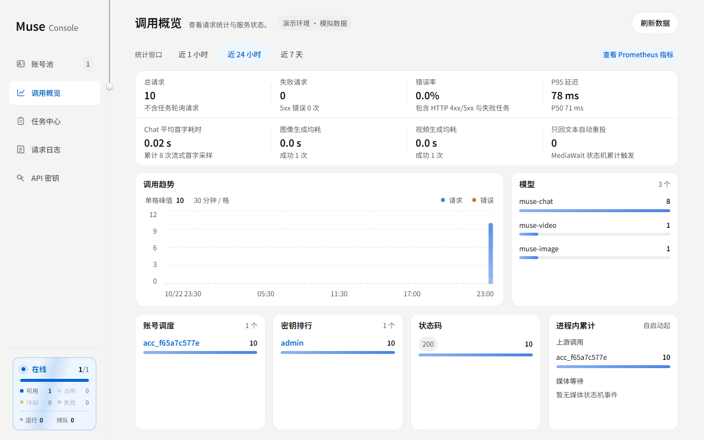
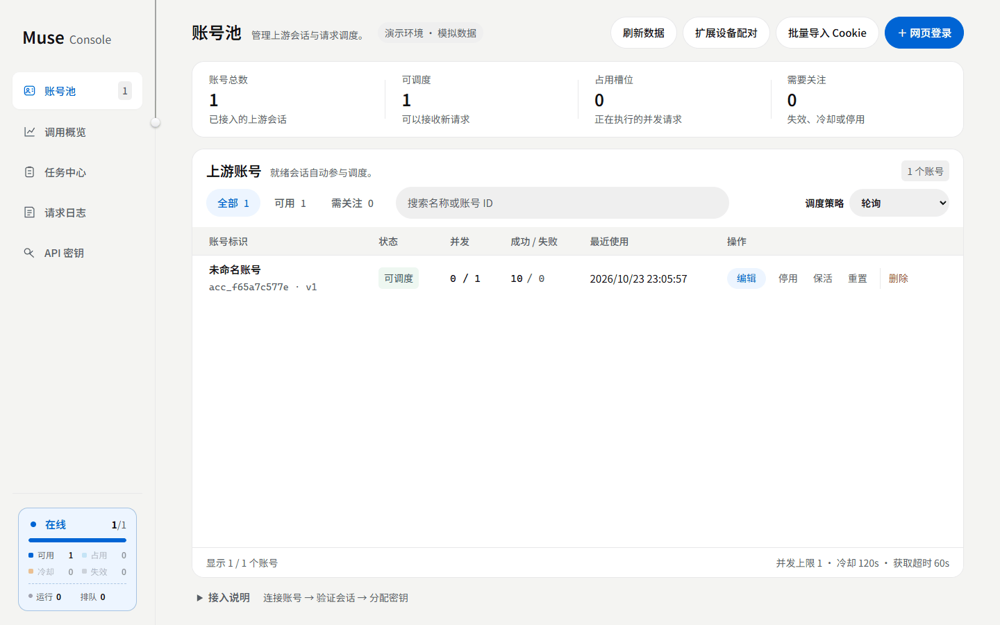

<div align="center">


<h1>Muse Console</h1>

<p><strong>Connect Muse to your AI tools. Manage accounts, keys and generation tasks in one console.</strong></p>

<p>English · <a href="README.zh-CN.md">简体中文</a> · <strong>0.4.3</strong> · Python <strong>3.10+</strong> · <strong>MIT</strong></p>

</div>

Muse Console is an independent, unofficial gateway for [muse.ai](https://muse.ai), exposing chat, image and video generation through a subset of OpenAI-style APIs. Self-hosted: your data stays on your server.



> Screenshots show the console in mock mode. The console and extension UI support English and Simplified Chinese; switch in the sidebar.

## How it works

```text
Chat clients / scripts / canvas tools
          ↓ OpenAI-style API
Muse Console: auth · account scheduling · async tasks · media access
          ↓ Dedicated Chromium browser
        muse.ai
```

Call the API from your tools and maintain the service through a web console. Clients do not need separate integrations for browser automation, account scheduling and upstream task polling.

## Why Muse Console

| Advantage | Implementation |
|---|---|
| **One integration** | One `/v1` base for chat, reference-image generation and video tasks, with streaming chat and a Responses subset |
| **Centralized accounts** | Browser login, batch import and an optional cookie extension; round-robin / LRU / affinity scheduling, per-account concurrency and cooldown |
| **Visible operations** | Account health, request statistics, task progress and error reasons in the console, plus Prometheus metrics |
| **Controlled access** | Separate client keys, task/media ownership checks, expiring download links and encrypted account payloads |
| **Developer-friendly** | Account-free mock mode and layered drivers keep UI, protocol and upstream work independent |

<details>
<summary>Account pool screenshot</summary>



</details>

## Quick start

With Docker, one command:

```bash
docker run -d --name muse-console -p 127.0.0.1:18610:18610 --shm-size 1g   -v muse-data:/app/data ghcr.io/yunmengxue42/muse-console:latest
docker logs muse-console
```

The log shows the console URL and a generated key. Open `http://127.0.0.1:18610/dashboard`, sign in with the key, then add accounts by web login, cookie import or the browser extension. Images are published for amd64 and arm64. With Compose: `docker compose up -d`.

The image runs the real browser driver. To try it without an account, add `-e MUSE_CONSOLE_DRIVER=mock`.

<details>
<summary>From source</summary>

Install **uv 0.12.11, Python 3.12 and Node.js 24**, then run in a fresh directory:

```bash
git clone https://github.com/YunMengXue42/muse-console.git
cd muse-console
uv sync --locked --extra dev --python 3.12
(cd frontend && npm ci && npm run build)
cp .env.example .env
uv run --no-sync muse-console
```

Source runs default to **mock mode**. For real Muse access, install Chromium/Chrome and set `MUSE_CONSOLE_DRIVER=browser`. In PowerShell, use `Copy-Item .env.example .env` and run the frontend commands separately.

</details>

Passwords, MFA and CAPTCHA require manual completion. Keep the port on loopback and put a TLS reverse proxy in front for remote access. [Deployment guide](docs/DEPLOYMENT.md)

## API example

Set your client's API base to `http://127.0.0.1:18610/v1` and use a client key created in the console.

```bash
curl http://127.0.0.1:18610/v1/chat/completions \
  -H "Authorization: Bearer $KEY" -H "Content-Type: application/json" \
  -d '{"model":"muse-chat","messages":[{"role":"user","content":"Hello"}],"stream":true}'
```

Prefer `muse-chat`, `muse-image` and `muse-video`. See the [API reference](docs/API.md) for endpoints, parameters and more examples.

## Browser extension

A companion MV3 extension makes onboarding accounts easier: log in to Muse as usual and the session syncs to your paired console, including later rotations. It reads only four Muse session cookies, sends them only to the single server you grant, and its device token can be revoked at any time.

See the [extension guide](extension/README.md) to install and pair.

## Boundaries

- **A compatibility subset, not a full OpenAI implementation.** Model aliases do not provide those vendors' actual models. Tool calling, structured output and masked inpainting are unsupported.
- **One process per deployment.** Run one worker per data directory. Automatic renewal is off by default; long-term renewal and multi-account load still need acceptance. The direct HTTP driver is unfinished.
- **Protect real credentials.** Use a dedicated browser profile. Set a separate admin key before sharing access and create client keys for callers. Do not share upstream accounts containing private memories among mutually untrusted users.
- **Back up completely.** Stop all writers and back up the whole data directory, including both the account database and `credentials.key`. Use trusted TLS for remote access and keep CDP private.

Build from source; no published PyPI package or container image is provided. Real generation depends on upstream pages, account state and quota.

## Documentation

[API and configuration](docs/API.md) · [Browser extension](extension/README.md) · [Deployment and backup](docs/DEPLOYMENT.md) · [Architecture](docs/ARCHITECTURE.md) · [Contributing](CONTRIBUTING.md) · [Security](SECURITY.md)

[Changelog](CHANGELOG.md) · [Roadmap](TODO.md) · [Publication checklist](docs/PUBLISHING.md)

## License and attribution

Derived from the MIT-licensed [www222fff/muse2api](https://github.com/www222fff/muse2api), independently maintained by [YunMengXue42](https://github.com/YunMengXue42/muse-console). Redistributions must preserve the original copyright and permission notice in [LICENSE](LICENSE).

This project is not affiliated with or endorsed by Muse, OpenAI or other model vendors. Follow upstream terms and account authorization. Software is provided as-is under the MIT license.
