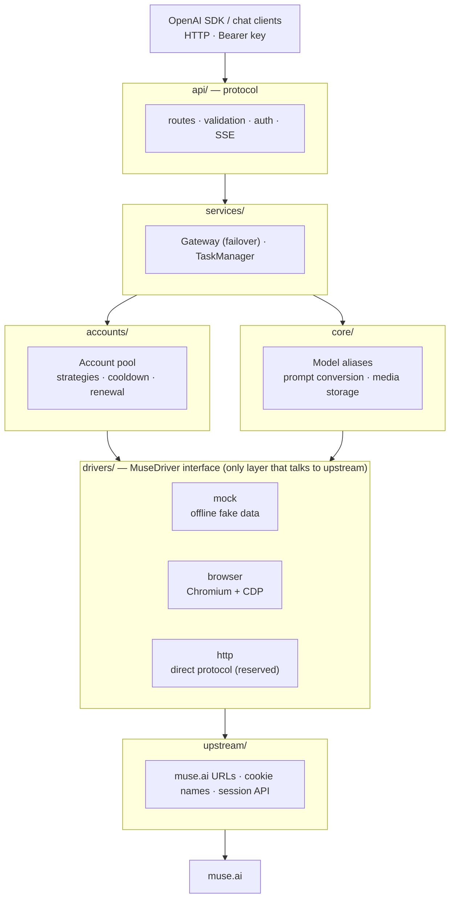

<h1 align="center">Muse Console</h1>

<p align="center">
  An async gateway that exposes the <a href="https://muse.ai">muse.ai</a> web app as an <b>OpenAI-compatible API</b>
</p>

<p align="center">
  
  
  
  <a href="https://github.com/YunMengXue42/muse-console/actions/workflows/ci.yml"></a>
  
  
</p>

---

## Contents

- [Overview](#overview)
- [Status](#status)
- [Architecture](#architecture)
- [Project layout](#project-layout)
- [Quick start](#quick-start)
- [API examples](#api-examples)
- [Configuration](#configuration)
- [Roadmap](#roadmap)
- [Contributing](#contributing)
- [Disclaimer](#disclaimer)
- [License and upstream attribution](#license-and-upstream-attribution)

## Overview

Muse Console exposes muse.ai chat, image and video generation through a subset of OpenAI-style endpoints. Basic clients can use a custom `base_url`; tool calling, exact token accounting and full OpenAI parameter semantics are not supported. Model aliases select Muse capabilities, not the named vendors' models.

The project focuses on **clean engineering and easy collaboration**:

- **Pluggable drivers**: how we reach upstream is abstracted behind a `MuseDriver` interface. There are currently a mock driver and a browser (CDP) driver, plus a reserved slot for a direct-protocol (HTTP) driver. They are fully independent of each other.
- **Strict layering**: the protocol layer, service layer, account pool and drivers each have a single responsibility and can be developed and tested on their own.
- **Async execution**: FastAPI + asyncio and a CDP WebSocket client, with explicit request, task and browser budgets. Local metadata persistence still performs bounded synchronous I/O.
- **Account pool**: fair round-robin by default, per-account concurrency limits, cooldown after failures, invalid-session exclusion and pre-output failover. Accounts are never silently deleted.
- **Offline development**: the mock driver needs no account and makes no network calls, so front-end and protocol work can move forward independently.

## Status

> **v0.3.6**: console upgrade — URL-hash routes, Prometheus metrics view, request filters by path/key, per-account concurrency and account merge. **v0.3.5**: adds optional streaming heartbeats, Prometheus metrics at `/admin/metrics` and automatic re-submission when a video reply arrives as text only. **v0.3.1, Muse Console rebuild**: account scheduling, encrypted persistence, batch import, isolated manual browser login and a React/TypeScript console are implemented. Offline regression tests exercise the real service boundaries with fake upstreams; successful live Muse authentication and generation are not implied by those tests.

| Module | Status | Notes |
|---|---|---|
| OpenAI protocol layer (chat streaming/non-streaming, images, videos, models) | ✅ Implemented | Multi-turn chat, system prompts, image input, model aliases |
| Account pool (scheduling / cooldown / invalidation / failover) | ✅ Implemented | `lru`, `round_robin` and `affinity` strategies |
| Background tasks (video) | ✅ Implemented | Create a task, then poll for the result; unfinished tasks are marked interrupted after a restart |
| Admin API (account CRUD, renewal, reset, status) | ✅ Implemented | |
| Mock driver | ✅ Implemented | Offline fake data |
| Browser driver (Chromium + CDP) | Implemented; previous live sample passed | Chat/image/video were exercised before this hardening revision; this revision still needs live regression |
| Session renewal / keepalive | 🧪 Needs live testing | Scoped browser renewal / legacy HTTP renewal; disabled by default |
| Direct HTTP protocol driver | 🚧 Reserved | Returns 501 |
| `/v1/images/edits` (reference images) | ✅ Implemented | Images are references for a new image; `mask` is rejected |
| `/v1/responses` | Implemented subset | Text/image input, instructions, ordinary and SSE output; no stored response state or tools |
| React console, batch import, encrypted SQLite account storage | Implemented | Independent frontend source and packaged static assets |
| Local media retention cleanup | Implemented | Optional mtime-based cleanup on startup and hourly housekeeping |
| Isolated manual browser login | Implemented; previous live sample passed | Owned contexts, TTL and upstream validation; no access to a daily browser profile |
| Cookie import extension | Implemented; previous transfer/sync sample passed | Read-only MV3 collection, restricted pairing and encrypted import; 72-hour renewal remains unverified |
| Quota lookup | Driver-dependent | Unsupported drivers return 501 |

## Architecture



**How a chat request is handled**: the route resolves the model alias and merges the multi-turn `messages` into a single prompt, then hands it to the Gateway. The Gateway leases an account from the pool and asks the driver for a text stream. On failure, the account's state is updated according to the error type: accounts with an expired session are taken offline, accounts out of quota cool down, and other errors cause a short cooldown. As long as nothing has been sent to the client yet, the request is retried on another account.

For streaming requests, the first chunk is fetched before returning 200. Errors such as "no account available" or "upstream authentication failed" therefore come back with a proper HTTP status code instead of a stream that breaks halfway.

See [docs/ARCHITECTURE.md](docs/ARCHITECTURE.md) for the full design.

## Project layout

```
muse-console/
├── src/muse_console/
│   ├── app.py                 # FastAPI app factory and lifespan
│   ├── config.py              # Settings (environment variables / .env)
│   ├── errors.py              # Error hierarchy → HTTP status + OpenAI error body
│   ├── api/
│   │   ├── deps.py            # Auth and dependency injection
│   │   ├── schemas.py         # OpenAI request models
│   │   └── routes/            # chat / images / videos / media / models / admin / responses
│   ├── services/
│   │   ├── gateway.py         # Runs driver calls on pooled accounts, retries on another account
│   │   ├── tasks.py           # Background long-running tasks
│   │   └── container.py       # Service wiring
│   ├── accounts/              # Account model, encrypted SQLite store, pool, keepalive
│   ├── core/                  # Model registry and aliases, prompt conversion, media storage
│   ├── drivers/
│   │   ├── base.py            # MuseDriver interface and data types
│   │   ├── mock.py
│   │   ├── browser/           # cdp.py / chromium.py / dom.py / driver.py
│   │   └── http/              # Reserved
│   ├── upstream/muse.py       # Upstream constants and session renewal
│   └── web/                   # Packaged console HTML and assets
├── frontend/                  # React / TypeScript pages, tests and Vite build
├── tests/                     # Offline service, persistence and fake-CDP regressions
├── docs/ARCHITECTURE.md
├── TODO.md                    # Task board for contributors
├── Dockerfile · docker-compose.yml · .env.example
└── CONTRIBUTING.md
```

## Quick start

### Run locally

```bash
# Clone from the actual Muse Console repository URL supplied by your distributor.
# Replace the placeholder; no public repository URL is assumed here.
git clone <MUSE_CONSOLE_REPOSITORY_URL> muse-console
cd muse-console
uv sync --locked --extra dev --python 3.12
(cd frontend && npm ci && npm run build)
cp .env.example .env      # defaults to mock; no account needed
uv run --no-sync muse-console  # listens on http://127.0.0.1:18610
```

If `MUSE_CONSOLE_API_KEY` is not set, a key is generated on first start and saved to `data/api_key`.

Install uv 0.12.11 as used in CI. On Windows PowerShell use `Copy-Item .env.example .env`; the uv/npm commands are otherwise the same. Build the console assets before packaging or starting from a source checkout; Vite writes them to `src/muse_console/web`.

### Docker

Compose builds `muse-console:local` from this checkout; this is a local tag, not a published registry identity. The image includes `LICENSE`, installs the local Python package and starts the `muse-console` CLI. Use a separate test data directory for acceptance; the commands below are deployment instructions, not a record of a completed build/run.

```bash
cp .env.example .env
docker compose up -d --build
```

### Use a real account (browser driver)

1. Install Chromium or Chrome and set `MUSE_CONSOLE_DRIVER=browser` in `.env`. Use a dedicated project profile inside the data directory, never a daily browser profile. First launch claims only a new/empty directory with `.muse-console-owned-profile` (valid legacy `.muse2api-owned-profile` markers remain recognized); existing nonempty unmarked profiles (including old project profiles) are refused. Use a new empty profile directory or an explicitly authorized manual migration; do not copy or stamp a daily browser profile.
2. Open `/dashboard` (also available at `/admin`) and authenticate with the admin key.
3. Choose **网页登录添加** to create a temporary, isolated browser session. Click the displayed page, send text and complete verification manually, then choose **完成验证并入池**. The server checks the upstream session before saving it. No password or CAPTCHA automation is implemented. `mock` and `http` drivers return 501 for browser login instead of pretending it succeeded.
4. Alternatively choose **批量导入**: paste or upload a JSON account array, browser cookie export, Netscape cookie file, or one Cookie header per line. Preview validates structure and deduplicates `hatch_sess`; it does not contact Muse to prove a live session. Each account requires `hatch_sess`; `hatch_gw`, `hatch_vml` and `hatch_native_auth_device` are forwarded when present.

### Automatic credential import (Chrome / Edge)

This is **automatic extraction after normal user authentication**, not unattended password/MFA login. The extension reads only the four Muse session cookies through the official cookies API, including HttpOnly and explicitly queried partitions. It never copies profiles, opens debugging on your main browser, changes/deletes browser cookies, or collects Google/Meta credentials.

1. Use a separate test deployment/data directory with the `browser` driver. Set `MUSE_CONSOLE_CREDENTIAL_INGESTION_ENABLED=true` and `MUSE_CONSOLE_CREDENTIAL_SERVER_ORIGIN=https://your-exact-service-origin` (no trailing slash). Keep the service single-process. TLS must be trusted; remote plain HTTP is refused. For local development only, explicitly set `MUSE_CONSOLE_CREDENTIAL_ALLOW_LOOPBACK_HTTP=true` with an exact loopback HTTP origin.
2. Build the extension: `cd extension && npm ci && npm run build && npm test`. The loadable directory is `extension/dist/`, containing only the manifest, bundled scripts and UI. Install it yourself in Chrome/Edge's extensions developer UI; installation/permissions require your explicit consent. Nothing in this repository auto-installs it or accesses your current profile.
3. On the account-pool page choose **扩展设备配对**, then generate a one-use challenge. In extension options enter the same exact server origin, grant permission for that target, query its identity and compare `server_id` and `fingerprint` with the console. The fingerprint is an application identity checksum, **not a TLS certificate pin**. Exchange the challenge; never give the extension your admin key.
4. Separately enable automatic synchronization, acknowledging that Muse session credentials will be sent to that server. Log in to Muse normally. Once cookies settle, the extension sends one store/partition snapshot and the backend probes `/api/session` in a project-owned temporary context before saving. No generation request is made by the import validator. The popup/options show only redacted states.
5. A device may initially add one account by default. Cookie rotation is not proof of stable account identity. If identity cannot be established, or a server renewal has advanced the version, the candidate is held for **one-capture administrator confirmation**. Verify the current Muse account, select its target account and exact capture in the console, then use the extension's resubmit-original-candidate action. Confirmation does not authorize all future account switches or blindly raise the extension's base version. A changed server version requires fresh confirmation. Lost session candidates must be recaptured and confirmed again.
6. Pause/forget stops extension synchronization but does not delete server accounts. Revoke its device grant in the console to stop future uploads. Tokens can be rotated and expire; they cannot read cookie values, list accounts or use admin APIs. Failed validation preserves existing credentials.

Extension secrets exist only in the worker's memory / trusted session storage; the limited device token persists in trusted extension local storage. The server stores only token hashes and redacted receipts in `credential-devices.db`; actual account payloads remain encrypted in `accounts.db`. Back up the full stopped data directory, including both databases and `credentials.key`. Receipts retain at most 30 days / 10,000 rows; source binding/quota high-water marks remain durable.

`MUSE_CONSOLE_LOGIN_AUTO_COMPLETE_ENABLED=true` optionally completes isolated server-side login after the user finishes authentication; it preserves cookie scope and cleans up the context. Manual completion remains available. Automatic renewal remains disabled by default pending live acceptance; scoped credentials renew through an owned browser context, legacy credentials retain the existing HTTP renewal path. Neither path guarantees permanent validity or portability across devices/IPs. Do not enable keepalive against real accounts until its upstream behavior is verified.

For TLS termination, bind the ASGI backend to loopback/a protected socket, make the proxy overwrite Host and forwarded scheme, and configure uvicorn to trust **only that fixed proxy address**, never `forwarded_allow_ips="*"`. The ingestion API checks the resulting ASGI origin against the configured exact origin, not caller-provided forwarding headers. No global CORS exception is enabled. Direct TLS is also supported through uvicorn deployment options.

Browser apps that call `/v1/*` from their own origin (the infinite-canvas workspace among them) need CORS at the proxy, not in the app. List each origin exactly and answer preflights there; do not open `*` or the dashboard:

```nginx
map $http_origin $api_origin {
    default "";
    "https://canvas.example.com" $http_origin;
}
map $api_origin $api_methods { default ""; "~." "GET, POST, PUT, PATCH, DELETE, OPTIONS"; }
map $api_origin $api_headers { default ""; "~." "authorization, content-type, accept"; }

location ^~ /v1/ {
    if ($request_method = OPTIONS) { return 204; }
    add_header Access-Control-Allow-Origin $api_origin always;
    add_header Access-Control-Allow-Methods $api_methods always;
    add_header Access-Control-Allow-Headers $api_headers always;
    add_header Vary Origin always;
    # add_header here replaces the server-level set: repeat HSTS, nosniff and Referrer-Policy.
}
```

`always` keeps the header on 4xx/5xx so a browser shows the real error instead of a CORS failure.

## API examples

Every `/v1/*` endpoint requires the header `Authorization: Bearer <API_KEY>`. The `/admin/*` endpoints use `MUSE_CONSOLE_ADMIN_KEY`, which defaults to the API key when unset.

**Chat (streaming)**

```bash
curl http://localhost:18610/v1/chat/completions \
  -H "Authorization: Bearer $KEY" -H "Content-Type: application/json" \
  -d '{"model":"gpt-4o","messages":[{"role":"user","content":"Hello"}],"stream":true}'
```

**OpenAI Python SDK**

```python
from openai import OpenAI

client = OpenAI(base_url="http://localhost:18610/v1", api_key="<API_KEY>")
resp = client.chat.completions.create(
    model="muse-chat",
    messages=[{"role": "user", "content": "Write a short poem about autumn"}],
)
print(resp.choices[0].message.content)
```

**Text to image**

```bash
curl http://localhost:18610/v1/images/generations \
  -H "Authorization: Bearer $KEY" -H "Content-Type: application/json" \
  -d '{"prompt":"A cyberpunk street on a rainy night","size":"16:9","response_format":"url"}'
```

**Transparent background**

muse.ai only returns flat RGB images, so `"background":"transparent"` cuts the subject out locally (BiRefNet + edge colour estimation) and returns an RGBA PNG. Requires `pip install -e '.[matting]'`; the model (~930MB) is downloaded to `~/.u2net` on first use. Expect ~30s extra per image on CPU.

```bash
curl http://localhost:18610/v1/images/generations \
  -H "Authorization: Bearer $KEY" -H "Content-Type: application/json" \
  -d '{"prompt":"A red fox sitting","background":"transparent"}'
```

**Image from reference images**

`"image"` takes one reference image or a list of up to 4 (data URL, http(s) URL or bare base64). They are attached to the muse.ai message like a chat upload, and the prompt says how to use them, e.g. put a product on a model, or "the same fox, now wearing a red scarf" to keep the subject and scene. `/v1/images/edits` does the same with OpenAI-style multipart uploads, so `client.images.edit()` works; `mask` (inpainting a region) is not supported.

```bash
curl http://localhost:18610/v1/images/generations \
  -H "Authorization: Bearer $KEY" -H "Content-Type: application/json" \
  -d '{"prompt":"A model wearing exactly this hoodie, studio photo","image":"data:image/jpeg;base64,..."}'

curl http://localhost:18610/v1/images/edits \
  -H "Authorization: Bearer $KEY" \
  -F "image[]=@fox.png" -F "prompt=The same fox, now wearing a red scarf"
```

**Image as an async task**

A sync image call (page load plus generation) can take longer than a reverse proxy allows; Cloudflare cuts it after about 100 s with HTTP 524. Add `"async": true` to get a task back, then poll it. Results are always stored as media URLs.

```bash
curl http://localhost:18610/v1/images/generations \
  -H "Authorization: Bearer $KEY" -H "Content-Type: application/json" \
  -d '{"prompt":"A red fox sitting","async":true}'          # -> {"id":"task_xxx","object":"image.task",...}
curl http://localhost:18610/v1/images/generations/task_xxx -H "Authorization: Bearer $KEY"
```

**Text to video (async task)**

```bash
# Create a task; returns {"id": "task_xxx", "status": "queued", ...}
curl http://localhost:18610/v1/videos   -H "Authorization: Bearer $KEY" -H "Content-Type: application/json"   -d '{"prompt":"Maple leaves falling in a light breeze","duration":5,"size":"16:9"}'

# Multipart works too, for clients that post a form instead of JSON
curl http://localhost:18610/v1/videos -H "Authorization: Bearer $KEY"   -F model=muse-video -F prompt="Maple leaves" -F seconds=5 -F size=1280x720   -F first_frame=@first.png

# Poll the task; once status is succeeded, video_url and result.url both point at the video
curl http://localhost:18610/v1/videos/task_xxx -H "Authorization: Bearer $KEY"
# Or download the bytes directly
curl -L http://localhost:18610/v1/videos/task_xxx/content -H "Authorization: Bearer $KEY" -o out.mp4
```

**Import an account**

```bash
curl http://localhost:18610/admin/accounts \
  -H "Authorization: Bearer $ADMIN_KEY" -H "Content-Type: application/json" \
  -d '{"label":"acc1","cookies":{"hatch_sess":"...","hatch_vml":"...","hatch_native_auth_device":"..."}}'
```

### Endpoints

| Method | Path | Description |
|---|---|---|
| GET | `/healthz` · `/readyz` | Liveness · readiness (driver state and available accounts) |
| GET | `/v1/models` | Model list, including aliases such as `gpt-4o` and `dall-e-3`. Unknown model names return 404 `model_not_found` |
| POST | `/v1/chat/completions` | Chat, streaming and non-streaming |
| POST | `/v1/images/generations` · GET `/v1/images/generations/{id}` | Text to image (optional `image` references), returns `url` or `b64_json`; `"async": true` returns a task to poll |
| POST | `/v1/images/edits` | Multipart `image`/`image[]` files + `prompt`, OpenAI-compatible |
| POST | `/v1/videos` · GET `/v1/videos/{id}` · GET `/v1/videos/{id}/content` | Create a video task (JSON or multipart) · query a task · download the finished file |
| GET | `/v1/media/{name}` | Owning-key/admin download or short-lived signed link |
| GET/POST/PATCH/DELETE | `/admin/accounts[/{id}]` | Account CRUD |
| POST | `/admin/accounts/{id}/renew` · `/reset` | Renew session · reset account state |
| POST | `/admin/accounts/{id}/merge` | `{"into": "acc_..."}` fold a duplicate entry into another, moving device bindings |
| GET | `/admin/status` · `/admin/tasks` | Service status · task list |
| GET/POST/PATCH/DELETE | `/admin/keys[/{id}]` | Client API keys (create returns the key once; PATCH renames / revokes) |
| GET | `/admin/requests` · `/admin/stats?window=1h\|24h\|7d` | Request log (filters: `key_id`, `account_id`, `status=2xx\|4xx\|5xx`, `path`, `since`, `hide_polls`) · aggregates |
| GET | `/dashboard` · `/admin` | React console (asks for the admin key in the browser) |
| POST | `/admin/accounts/import` | `{content, preview}` batch import with per-row results |
| GET/PATCH | `/admin/pool` | Pool status and persistent scheduling strategy |
| POST/GET/DELETE | `/admin/login-sessions[/{id}]` | Create, inspect or cancel an isolated manual login |
| GET/POST | `/admin/login-sessions/{id}/frame` · `/input` · `/complete` | Read screenshot, send allowlisted input, validate and import |
| GET/POST/DELETE | `/admin/credential-devices` · `/pairings` · `/{id}` | List restricted devices, create one-use pairing challenge, revoke a device (admin only) |
| POST | `/admin/credential-devices/{id}/confirm` | Confirm only `{capture_id, account_id}` after checking identity/version |
| GET/POST | `/credential-ingestions/server` · `/pair` · `/rotate` | Server identity, challenge exchange, restricted device-token rotation |
| POST/GET | `/credential-ingestions` · `/{capture_id}` | Scope-preserving candidate import / own redacted receipt (device token only, 64 KiB limit) |
| POST | `/v1/responses` | Stateless text/image input and ordinary/SSE output; unsupported controls return 400 |

### Dashboard, API keys and request log

Open `http://localhost:18610/dashboard` and enter the admin key. The React console keeps it in `sessionStorage`, clears it on logout, and sends it as a Bearer token to `/admin/*`. Account pool, request statistics, async tasks, filtered request logs and client key management use real backend APIs. The visual system follows Muse's public blue/white palette; this remains an independent, unofficial management tool.

Accounts are stored as authenticated encrypted payloads in `data/accounts.db` using `data/credentials.key`. Back up **both** while the service is stopped. Losing the key makes encrypted accounts unrecoverable; the service fails closed rather than overwriting them. A legacy `accounts.json` is imported once without deleting or editing the source. That preserved file can still contain plaintext credentials: restrict its permissions and handle its retirement separately. Windows `chmod` does not replace NTFS ACL management. Encryption at rest does not protect against an attacker who can read both the database and key.

Use one application process/worker. Scheduling and browser leases are process-local; running multiple workers against the same data directory is not supported. Default scheduling is fair round-robin; `lru` and `affinity` remain selectable. Busy accounts wait up to the acquire deadline; invalid accounts are excluded and cooling accounts rejoin after their cooldown. A stream never switches accounts after emitting content. From v0.3.1, chat reuse keys are derived from the authenticated API-key identity plus the optional OpenAI `user` hint; a caller cannot select another key's reuse namespace. Sharing one API key also shares its namespace: use distinct keys for distinct callers. Same-key/same-hint chat execution is serialized.

Browser login controls are admin-only, accept a small input allowlist and never expose a CDP endpoint. Sessions expire by default after 600 seconds, with at most 3 simultaneous login windows. Do not expose the admin service over plain HTTP on an untrusted network. Docker publishes to loopback by default; put a TLS reverse proxy in front before deliberately broadening access.

Besides the admin key and `MUSE_CONSOLE_API_KEY` (still accepted, logged as `legacy`), `/v1/*` accepts any non-revoked key created on the dashboard or with `POST /admin/keys {"name": "..."}`. Keys look like `m2a-...` and are shown once; `data/keys.json` stores only their SHA-256 hash and an 8-character prefix. Every `/v1/*` request (except `/v1/media/*` downloads, which may contain bearer-link query parameters) is recorded in `data/requests.db` (SQLite) with its key, model, account, status, latency and client IP (`CF-Connecting-IP` / `X-Forwarded-For` aware). Task status polls are flagged so the dashboard and stats can leave them out.

### Ownership and resource boundaries

Image/video tasks belong to the authenticated key that submitted them. Other ordinary keys receive 404; the administrator can inspect all tasks. Old tasks without an owner remain administrator-only. This is a deliberate migration boundary, not an invitation to infer ownership from historical prompts.

Generated media require the owning key/admin key, or an expiring signed URL (default one hour). Links are bearer capabilities: recipients can share them until expiry. Revoking a stored client key invalidates its signed links. Task polling refreshes result links after ownership checks. Legacy media without ownership metadata are administrator-only. Responses use `private, no-store`; preserve `media-owners.db` and `media-signing.key` in backups. Old public links no longer work without authentication after upgrade.

Defaults: 12 MiB request body, 16 in-flight generation HTTP requests, 32 queued/running tasks, 4 task runners, 8 MiB per input image, 32 MiB per output file and 1 GiB media storage. Reaching a generation/queue/storage budget returns 429; oversized request bodies return 413. These are local safety limits, not throughput guarantees. Account concurrency remains independently configured. Storage is not silently deleted when full; configure retention or explicitly free space.

Reference URL downloads accept public HTTP(S) raster images only. DNS results are validated and connections pinned to an approved IP with hostname TLS verification; each redirect is revalidated. Proxy environment variables are not used for this path. Private/link-local/metadata destinations, unsafe redirects and oversized responses are rejected. Keep network-level egress controls as defense in depth.

API-key conversation namespacing does not erase Muse account memory. Do not share an account containing private upstream memories between mutually untrusted users. This release does not claim tenant-isolated upstream accounts, per-key billing or a durable distributed queue.

### Execution safety (v0.3.1)

Media generation is deliberately not automatically replayed on another account after errors: the browser adapter cannot prove whether the upstream already accepted or charged for it. A timeout is not proof that generation never happened. Inspect upstream results before manually retrying. Multi-image partial-result recovery and exactly-once execution are not implemented.

Task cancellation waits for local cleanup; it does **not** prove that Muse stopped generating or refunded quota. Interrupted browser tabs are retired. Active/queued tasks are retained independently of the completed-history cap; task runners have bounded local concurrency. This remains an in-process worker, not a durable distributed job queue.

### Protocol support matrix

| Surface | Supported | Explicitly not supported |
|---|---|---|
| Chat | Full-history text, system/developer/user/assistant roles, user images, ordinary/SSE output, optional usage event | Tool/function execution, audio/files, structured output, enforced token limits, stop sequences and sampling controls |
| Responses | Text/image input, instructions, metadata echo, ordinary/SSE events, `store:false` | Stored state, previous response/conversation references, tools, background execution, reasoning controls and JSON schema output |
| Images | 1–4 sequential results, up to 4 references, URL/base64 output, optional local transparent cutout | Mask inpainting, style/output-format controls, non-neutral `quality` |
| Video | Async task, optional first-frame image, consistent duration/seconds and image/input_reference aliases | Guaranteed exact dimensions or duration |
| Models | Muse chat/image/video plus compatibility aliases | Access to the actual GPT/Claude/DeepSeek models named by aliases |

Unknown controls return 400 rather than being silently ignored. Chat/Responses accept neutral client defaults: `temperature/top_p=1`, penalties `0`, `n=1`, empty tools, `tool_choice:auto/none`, text-only response format and `store:false`; meaningful unsupported values are rejected. Image `size` and video size/duration are natural-language hints, not guaranteed generation parameters. Image `quality` is accepted only as `auto` or empty because clients such as infinite-canvas send it on every call; other values return 400, and `background: ""` means unset. Video accepts `application/json`, `multipart/form-data` and form-encoded bodies: `first_frame` (or the first `image[]`) becomes the single reference frame, while `last_frame`, `video[]` and `audio[]` references return 400 because Muse is driven here by a prompt plus one image. `mode`, `resolution_name`, `generate_audio` and `watermark` are accepted and ignored. Usage is a text-length estimate, excluding image cost and upstream billing. SSE follows page updates and may arrive in large chunks rather than token-by-token. Official SDK acceptance remains a separate gate.

### Upgrade, backup and rollback

1. Stop every data writer and back up the entire data directory plus the matched old source/image. `tools/backup_restore.py backup --data <stopped-data> --output <new-backup-dir> --stopped` creates an exclusive, hash-verified copy; it never stops services for you. Existing targets, symlinks/reparse paths, hardlinks and SQLite sidecars are refused. Never test against your only production data.
2. Start this rebuild with a copy in a separate data directory and port. Check `/readyz`, admin login, import preview, account distribution and a real upstream request before cutover.
3. Legacy JSON import does not edit the original. New changes are written only to SQLite; a legacy binary cannot read them. To roll back, stop the rebuild and restore the **matched pre-upgrade source/image and full data backup**, not just `accounts.json` on top of newer data.
4. Keep `credentials.key`, account/device databases, media ownership/signing files and all other data together, protected by filesystem access controls. To restore, use `tools/backup_restore.py restore --backup <backup-dir> --output <new-restore-dir> --stopped`, then start the matching release against that new directory. Never overlay a partial backup. Hashes detect corruption, not malicious replacement. Backup archives contain secrets and must never enter source deliveries or bug reports.

Read-only observation is available with `python tools/soak_check.py --base-url http://127.0.0.1:18610 --duration 10 --interval 1 --report <new-report.jsonl>`. URL, duration and report are explicit; remote targets require HTTPS. Add `--admin-key-env <VARIABLE_NAME>` for redacted aggregate counts. It runs in the foreground, performs GET only, follows no redirects and never generates content, renews sessions or stores response bodies. A 72-hour health report alone does not prove credentials remain usable for generation.

Validation must be performed for the exact revision being deployed. Offline tests and mock-driver checks do not establish live Muse authentication/generation, Docker runtime readiness or a successful GitHub Actions run. This hardening revision does not certify those acceptance gates.

## Configuration

All settings come from environment variables (preferred prefix `MUSE_CONSOLE_`) or a `.env` file. Legacy `MUSE2API_` aliases remain supported by the core configuration layer; when both names for a setting are supplied, the `MUSE_CONSOLE_` name takes precedence. Use only the new names in new deployments. See [.env.example](.env.example) for the full list. The most common ones:

| Variable | Default | Description |
|---|---|---|
| `MUSE_CONSOLE_DRIVER` | `mock` | Driver: `mock` / `browser` / `http` |
| `MUSE_CONSOLE_HOST` · `MUSE_CONSOLE_PORT` | `127.0.0.1` · `18610` | Listen address and port |
| `MUSE_CONSOLE_API_KEY` | auto-generated | Key for `/v1/*` endpoints |
| `MUSE_CONSOLE_ADMIN_KEY` | same as API key | Key for `/admin/*` endpoints |
| `MUSE_CONSOLE_REQUEST_LOG_RETENTION_DAYS` | `14` | Days of request history kept in `data/requests.db` |
| `MUSE_CONSOLE_MEDIA_RETENTION_DAYS` | `0` | Days to retain generated files; `0` disables automatic cleanup |
| `MUSE_CONSOLE_MEDIA_URL_TTL` | `3600` | Signed media link lifetime, seconds |
| `MUSE_CONSOLE_MEDIA_MAX_BYTES` · `MUSE_CONSOLE_BROWSER_MEDIA_MAX_BYTES` | `33554432` | Output storage / browser attachment byte budgets |
| `MUSE_CONSOLE_MEDIA_STORAGE_MAX_BYTES` | `1073741824` | Total local media budget; full storage rejects new saves |
| `MUSE_CONSOLE_INPUT_IMAGE_MAX_BYTES` | `8388608` | Per input image byte limit |
| `MUSE_CONSOLE_REQUEST_MAX_BYTES` · `MUSE_CONSOLE_REQUEST_MAX_INFLIGHT` | `12582912` · `16` | Request body / in-flight generation HTTP limits |
| `MUSE_CONSOLE_TASK_MAX_PENDING` · `MUSE_CONSOLE_TASK_MAX_CONCURRENT` | `32` · `4` | Queued+running jobs / runner limits |
| `MUSE_CONSOLE_BROWSER_MAX_TABS` · `MUSE_CONSOLE_BROWSER_IDLE_TTL` | `16` · `900` | Generation-tab budget / idle cleanup seconds; manual login and credential probes have separate limits |
| `MUSE_CONSOLE_PUBLIC_BASE` | empty | Public base URL used in media links; derived from the request when empty |
| `MUSE_CONSOLE_POOL_STRATEGY` | `round_robin` | Account scheduling: `lru` / `round_robin` / `affinity` |
| `MUSE_CONSOLE_MAX_FAILOVER` | `2` | Maximum pre-output chat retries on another account; media is not automatically replayed |
| `MUSE_CONSOLE_ACCOUNT_MAX_CONCURRENCY` | `1` | Default parallel requests per account (1–16); each account may override it |
| `MUSE_CONSOLE_LOGIN_SESSION_TTL` | `600` | Manual login lifetime in seconds (30–1800) |
| `MUSE_CONSOLE_LOGIN_SESSION_LIMIT` | `3` | Simultaneous manual login contexts (1–10) |
| `MUSE_CONSOLE_LOGIN_AUTO_COMPLETE_ENABLED` | `false` | Detect successful isolated login and validate/import automatically |
| `MUSE_CONSOLE_CREDENTIAL_INGESTION_ENABLED` | `false` | Enable restricted extension pairing/import APIs |
| `MUSE_CONSOLE_CREDENTIAL_SERVER_ORIGIN` | empty | Exact HTTPS receiver origin; required when ingestion is enabled |
| `MUSE_CONSOLE_CREDENTIAL_ALLOW_LOOPBACK_HTTP` | `false` | Explicit local-development exception; never permits LAN/public HTTP |
| `MUSE_CONSOLE_CHROMIUM_PATH` | auto-detected | Path to the browser executable |
| `MUSE_CONSOLE_KEEPALIVE_ENABLED` | `false` | Periodically renew sessions in the background |
| `MUSE_CONSOLE_MATTING_MODEL` | `birefnet-general` | Model for `background: "transparent"` (`birefnet-general-lite` is faster) |

## Roadmap

All reserved modules and outstanding work are tracked in **[TODO.md](TODO.md)**, in four groups:

- **Live verification (do first)**: run live regression for the exact hardening revision, then multi-account load and 72-hour renewal observation. Earlier real-account samples are not substitutes.
- **Drivers**: direct HTTP protocol driver, conversation thread reuse, quota lookup.
- **Protocol**: official SDK acceptance for the implemented subset and mask-based inpainting. Streaming heartbeats are available via `MUSE_CONSOLE_STREAM_HEARTBEAT_INTERVAL` (off by default). Tool calling is not currently supported.
- **Accounts, admin and operations**: 72-hour renewal acceptance, multi-account load validation, per-key quotas/rate limits. Process-local Prometheus metrics are served at `/admin/metrics` (admin key). Distributed scheduling is outside the single-worker contract.

Each task lists its location, approach and definition of done. Places marked `TODO(contributors)` in the code are the reserved extension points.

## Contributing

You are welcome to pick up any task in [TODO.md](TODO.md). Please open an issue describing what you plan to do before you start; see [CONTRIBUTING.md](CONTRIBUTING.md) for conventions.

```bash
uv sync --locked --extra dev
uv run --no-sync ruff format .
uv run --no-sync ruff check .
uv run --no-sync pytest    # offline; no real Muse account required
cd frontend
npm ci
npm run format
npm run lint
npm test
npm run build
```

## Disclaimer

This project is for learning and technical research only. Please comply with muse.ai's terms of service and local laws. Never commit or publish account cookies.

## License and upstream attribution

Muse Console is derived from [www222fff/muse2api](https://github.com/www222fff/muse2api), the MIT-licensed upstream project. The upstream repository is a source attribution, not the Muse Console repository; its stars, releases and maintainers must not be represented as those of this project.

[LICENSE](LICENSE) retains the original MIT terms and `Copyright (c) 2026 www222fff`. Redistributed copies and substantial portions must retain that copyright and permission notice, including in packages and container images. The rename does not transfer copyright or imply upstream endorsement.

Muse Console is maintained independently at [YunMengXue42/muse-console](https://github.com/YunMengXue42/muse-console). The distribution/CLI name is `muse-console`; the Python module/package is `muse_console`. There is no published PyPI release or Docker registry image; installation examples use the local source, and Compose builds a local image. See [CHANGELOG.md](CHANGELOG.md) for release notes and [SECURITY.md](SECURITY.md) for reporting vulnerabilities.
