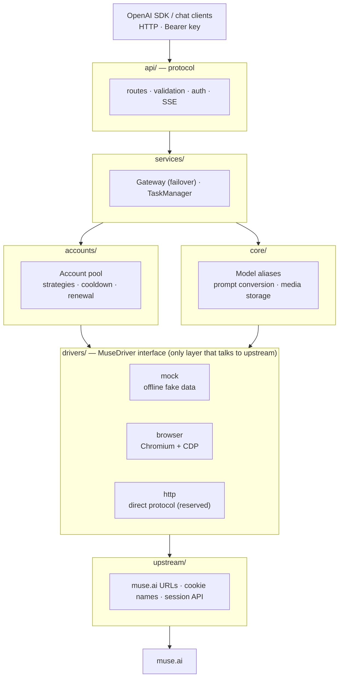

<h1 align="center">muse2api</h1>

<p align="center">
  An async gateway that exposes the <a href="https://muse.ai">muse.ai</a> web app as an <b>OpenAI-compatible API</b>
</p>

<p align="center">
  
  
  
  
  
</p>

---

## Contents

- [Overview](#overview)
- [Status](#status)
- [Architecture](#architecture)
- [Project layout](#project-layout)
- [Quick start](#quick-start)
- [API examples](#api-examples)
- [Configuration](#configuration)
- [Roadmap](#roadmap)
- [Contributing](#contributing)
- [Disclaimer](#disclaimer)
- [Star History](#star-history)

## Overview

muse2api turns muse.ai's chat, text-to-image and text-to-video features into standard OpenAI endpoints (`/v1/chat/completions`, `/v1/images/generations`, ...). Existing OpenAI SDKs and clients such as ChatGPT-Next-Web, LobeChat or Cherry Studio work by just changing their `base_url`.

The project focuses on **clean engineering and easy collaboration**:

- **Pluggable drivers**: how we reach upstream is abstracted behind a `MuseDriver` interface. There are currently a mock driver and a browser (CDP) driver, plus a reserved slot for a direct-protocol (HTTP) driver. They are fully independent of each other.
- **Strict layering**: the protocol layer, service layer, account pool and drivers each have a single responsibility and can be developed and tested on their own.
- **Fully async**: built on FastAPI + asyncio; the CDP client uses `websockets`, so no request ever blocks a thread.
- **Account pool**: fair round-robin by default, per-account concurrency limits, cooldown after failures, invalid-session exclusion and pre-output failover. Accounts are never silently deleted.
- **Offline development**: the mock driver needs no account and makes no network calls, so front-end and protocol work can move forward independently.

## Status

> **v0.3.1, Muse Console rebuild**: account scheduling, encrypted persistence, batch import, isolated manual browser login and a React/TypeScript console are implemented. Offline regression tests exercise the real service boundaries with fake upstreams; successful live Muse authentication and generation are not implied by those tests.

| Module | Status | Notes |
|---|---|---|
| OpenAI protocol layer (chat streaming/non-streaming, images, videos, models) | ✅ Implemented | Multi-turn chat, system prompts, image input, model aliases |
| Account pool (scheduling / cooldown / invalidation / failover) | ✅ Implemented | `lru`, `round_robin` and `affinity` strategies |
| Background tasks (video) | ✅ Implemented | Create a task, then poll for the result; unfinished tasks are marked interrupted after a restart |
| Admin API (account CRUD, renewal, reset, status) | ✅ Implemented | |
| Mock driver | ✅ Implemented | Offline fake data |
| Browser driver (Chromium + CDP) | 🧪 Needs live testing | Full chat, image and video flows are written |
| Session renewal / keepalive | 🧪 Needs live testing | Plain HTTP, disabled by default |
| Direct HTTP protocol driver | 🚧 Reserved | Returns 501 |
| `/v1/images/edits` (reference images) | ✅ Implemented | Images are references for a new image; `mask` is rejected |
| `/v1/responses` | 🚧 Reserved | Returns 501 |
| React console, batch import, encrypted SQLite account storage | Implemented | Independent frontend source and packaged static assets |
| Local media retention cleanup | Implemented | Optional mtime-based cleanup on startup and hourly housekeeping |
| Isolated manual browser login | Needs live testing | Temporary contexts, TTL and upstream validation; fake-CDP regression coverage |
| Cookie import extension | Reserved | Use console import instead |
| Quota lookup | Driver-dependent | Unsupported drivers return 501 |

## Architecture



**How a chat request is handled**: the route resolves the model alias and merges the multi-turn `messages` into a single prompt, then hands it to the Gateway. The Gateway leases an account from the pool and asks the driver for a text stream. On failure, the account's state is updated according to the error type: accounts with an expired session are taken offline, accounts out of quota cool down, and other errors cause a short cooldown. As long as nothing has been sent to the client yet, the request is retried on another account.

For streaming requests, the first chunk is fetched before returning 200. Errors such as "no account available" or "upstream authentication failed" therefore come back with a proper HTTP status code instead of a stream that breaks halfway.

See [docs/ARCHITECTURE.md](docs/ARCHITECTURE.md) for the full design.

## Project layout

```
muse2api/
├── src/muse2api/
│   ├── app.py                 # FastAPI app factory and lifespan
│   ├── config.py              # Settings (environment variables / .env)
│   ├── errors.py              # Error hierarchy → HTTP status + OpenAI error body
│   ├── api/
│   │   ├── deps.py            # Auth and dependency injection
│   │   ├── schemas.py         # OpenAI request models
│   │   └── routes/            # chat / images / videos / media / models / admin / responses
│   ├── services/
│   │   ├── gateway.py         # Runs driver calls on pooled accounts, retries on another account
│   │   ├── tasks.py           # Background long-running tasks
│   │   └── container.py       # Service wiring
│   ├── accounts/              # Account model, encrypted SQLite store, pool, keepalive
│   ├── core/                  # Model registry and aliases, prompt conversion, media storage
│   ├── drivers/
│   │   ├── base.py            # MuseDriver interface and data types
│   │   ├── mock.py
│   │   ├── browser/           # cdp.py / chromium.py / dom.py / driver.py
│   │   └── http/              # Reserved
│   └── upstream/muse.py       # Upstream constants and session renewal
├── frontend/                  # React / TypeScript pages, tests and Vite build
├── tests/                     # Offline service, persistence and fake-CDP regressions
├── docs/ARCHITECTURE.md
├── TODO.md                    # Task board for contributors
├── Dockerfile · docker-compose.yml · .env.example
└── CONTRIBUTING.md
```

## Quick start

### Run locally

```bash
# Use the rebuilt source directory from this delivery; the upstream URL is a reference.
cd muse2api
python3 -m venv .venv && source .venv/bin/activate
pip install -e '.[dev]'
(cd frontend && npm ci && npm run build)
cp .env.example .env      # defaults to MUSE2API_DRIVER=mock, no account needed
python -m muse2api        # listens on http://127.0.0.1:18610 by default
```

If `MUSE2API_API_KEY` is not set, a key is generated on first start and saved to `data/api_key`.

On Windows PowerShell, use `py -3 -m venv .venv`, `.venv\\Scripts\\Activate.ps1` and `Copy-Item .env.example .env`; the remaining Python/npm commands are the same. This rebuild's source archive includes prebuilt console assets, but rebuild after changing the frontend.

### Docker

```bash
cp .env.example .env
docker compose up -d --build
```

### Use a real account (browser driver)

1. Install Chromium or Chrome and set `MUSE2API_DRIVER=browser` in `.env`.
2. Open `/dashboard` (also available at `/admin`) and authenticate with the admin key.
3. Choose **网页登录添加** to create a temporary, isolated browser session. Click the displayed page, send text and complete verification manually, then choose **完成验证并入池**. The server checks the upstream session before saving it. No password or CAPTCHA automation is implemented. `mock` and `http` drivers return 501 for browser login instead of pretending it succeeded.
4. Alternatively choose **批量导入**: paste or upload a JSON account array, browser cookie export, Netscape cookie file, or one Cookie header per line. Preview validates structure and deduplicates `hatch_sess`; it does not contact Muse to prove a live session. Each account requires `hatch_sess`, `hatch_gw`, `hatch_vml` and `hatch_native_auth_device`.

## API examples

Every `/v1/*` endpoint requires the header `Authorization: Bearer <API_KEY>`. The `/admin/*` endpoints use `MUSE2API_ADMIN_KEY`, which defaults to the API key when unset.

**Chat (streaming)**

```bash
curl http://localhost:18610/v1/chat/completions \
  -H "Authorization: Bearer $KEY" -H "Content-Type: application/json" \
  -d '{"model":"gpt-4o","messages":[{"role":"user","content":"Hello"}],"stream":true}'
```

**OpenAI Python SDK**

```python
from openai import OpenAI

client = OpenAI(base_url="http://localhost:18610/v1", api_key="<API_KEY>")
resp = client.chat.completions.create(
    model="muse-chat",
    messages=[{"role": "user", "content": "Write a short poem about autumn"}],
)
print(resp.choices[0].message.content)
```

**Text to image**

```bash
curl http://localhost:18610/v1/images/generations \
  -H "Authorization: Bearer $KEY" -H "Content-Type: application/json" \
  -d '{"prompt":"A cyberpunk street on a rainy night","size":"16:9","response_format":"url"}'
```

**Transparent background**

muse.ai only returns flat RGB images, so `"background":"transparent"` cuts the subject out locally (BiRefNet + edge colour estimation) and returns an RGBA PNG. Requires `pip install -e '.[matting]'`; the model (~930MB) is downloaded to `~/.u2net` on first use. Expect ~30s extra per image on CPU.

```bash
curl http://localhost:18610/v1/images/generations \
  -H "Authorization: Bearer $KEY" -H "Content-Type: application/json" \
  -d '{"prompt":"A red fox sitting","background":"transparent"}'
```

**Image from reference images**

`"image"` takes one reference image or a list of up to 4 (data URL, http(s) URL or bare base64). They are attached to the muse.ai message like a chat upload, and the prompt says how to use them, e.g. put a product on a model, or "the same fox, now wearing a red scarf" to keep the subject and scene. `/v1/images/edits` does the same with OpenAI-style multipart uploads, so `client.images.edit()` works; `mask` (inpainting a region) is not supported.

```bash
curl http://localhost:18610/v1/images/generations \
  -H "Authorization: Bearer $KEY" -H "Content-Type: application/json" \
  -d '{"prompt":"A model wearing exactly this hoodie, studio photo","image":"data:image/jpeg;base64,..."}'

curl http://localhost:18610/v1/images/edits \
  -H "Authorization: Bearer $KEY" \
  -F "image[]=@fox.png" -F "prompt=The same fox, now wearing a red scarf"
```

**Image as an async task**

A sync image call (page load plus generation) can take longer than a reverse proxy allows; Cloudflare cuts it after about 100 s with HTTP 524. Add `"async": true` to get a task back, then poll it. Results are always stored as media URLs.

```bash
curl http://localhost:18610/v1/images/generations \
  -H "Authorization: Bearer $KEY" -H "Content-Type: application/json" \
  -d '{"prompt":"A red fox sitting","async":true}'          # -> {"id":"task_xxx","object":"image.task",...}
curl http://localhost:18610/v1/images/generations/task_xxx -H "Authorization: Bearer $KEY"
```

**Text to video (async task)**

```bash
# Create a task; returns {"id": "task_xxx", "status": "queued", ...}
curl http://localhost:18610/v1/videos \
  -H "Authorization: Bearer $KEY" -H "Content-Type: application/json" \
  -d '{"prompt":"Maple leaves falling in a light breeze","duration":5,"size":"16:9"}'

# Poll the task; on success, result.url points to the video
curl http://localhost:18610/v1/videos/task_xxx -H "Authorization: Bearer $KEY"
```

**Import an account**

```bash
curl http://localhost:18610/admin/accounts \
  -H "Authorization: Bearer $ADMIN_KEY" -H "Content-Type: application/json" \
  -d '{"label":"acc1","cookies":{"hatch_sess":"...","hatch_gw":"...","hatch_vml":"...","hatch_native_auth_device":"..."}}'
```

### Endpoints

| Method | Path | Description |
|---|---|---|
| GET | `/healthz` · `/readyz` | Liveness · readiness (driver state and available accounts) |
| GET | `/v1/models` | Model list, including aliases such as `gpt-4o` and `dall-e-3` |
| POST | `/v1/chat/completions` | Chat, streaming and non-streaming |
| POST | `/v1/images/generations` · GET `/v1/images/generations/{id}` | Text to image (optional `image` references), returns `url` or `b64_json`; `"async": true` returns a task to poll |
| POST | `/v1/images/edits` | Multipart `image`/`image[]` files + `prompt`, OpenAI-compatible |
| POST | `/v1/videos` · GET `/v1/videos/{id}` | Create a video task · query a task |
| GET | `/v1/media/{name}` | Download generated media |
| GET/POST/PATCH/DELETE | `/admin/accounts[/{id}]` | Account CRUD |
| POST | `/admin/accounts/{id}/renew` · `/reset` | Renew session · reset account state |
| GET | `/admin/status` · `/admin/tasks` | Service status · task list |
| GET/POST/PATCH/DELETE | `/admin/keys[/{id}]` | Client API keys (create returns the key once; PATCH renames / revokes) |
| GET | `/admin/requests` · `/admin/stats?window=1h\|24h\|7d` | Request log (filters: `key_id`, `account_id`, `status=2xx\|4xx\|5xx`, `path`, `since`, `hide_polls`) · aggregates |
| GET | `/dashboard` · `/admin` | React console (asks for the admin key in the browser) |
| POST | `/admin/accounts/import` | `{content, preview}` batch import with per-row results |
| GET/PATCH | `/admin/pool` | Pool status and persistent scheduling strategy |
| POST/GET/DELETE | `/admin/login-sessions[/{id}]` | Create, inspect or cancel an isolated manual login |
| GET/POST | `/admin/login-sessions/{id}/frame` · `/input` · `/complete` | Read screenshot, send allowlisted input, validate and import |
| POST | `/v1/responses` | Reserved, currently returns 501 |

### Dashboard, API keys and request log

Open `http://localhost:18610/dashboard` and enter the admin key. The React console keeps it in `sessionStorage`, clears it on logout, and sends it as a Bearer token to `/admin/*`. Account pool, request statistics, async tasks, filtered request logs and client key management use real backend APIs. The visual system follows Muse's public blue/white palette; this remains an independent, unofficial management tool.

Accounts are stored as authenticated encrypted payloads in `data/accounts.db` using `data/credentials.key`. Back up **both** while the service is stopped. Losing the key makes encrypted accounts unrecoverable; the service fails closed rather than overwriting them. A legacy `accounts.json` is imported once without deleting or editing the source. That preserved file can still contain plaintext credentials: restrict its permissions and handle its retirement separately. Windows `chmod` does not replace NTFS ACL management. Encryption at rest does not protect against an attacker who can read both the database and key.

Use one application process/worker. Scheduling and browser leases are process-local; running multiple workers against the same data directory is not supported. Default scheduling is fair round-robin; `lru` and `affinity` remain selectable. Busy accounts wait up to the acquire deadline; invalid accounts are excluded and cooling accounts rejoin after their cooldown. A stream never switches accounts after emitting content. From v0.3.1, chat reuse keys are derived from the authenticated API-key identity plus the optional OpenAI `user` hint; a caller cannot select another key's reuse namespace. Sharing one API key also shares its namespace: use distinct keys for distinct callers. Same-key/same-hint chat execution is serialized.

Browser login controls are admin-only, accept a small input allowlist and never expose a CDP endpoint. Sessions expire by default after 600 seconds, with at most 3 simultaneous login windows. Do not expose the admin service over plain HTTP on an untrusted network. Docker publishes to loopback by default; put a TLS reverse proxy in front before deliberately broadening access.

Besides the admin key and `MUSE2API_API_KEY` (still accepted, logged as `legacy`), `/v1/*` accepts any non-revoked key created on the dashboard or with `POST /admin/keys {"name": "..."}`. Keys look like `m2a-...` and are shown once; `data/keys.json` stores only their SHA-256 hash and an 8-character prefix. Every `/v1/*` request (except `/v1/media/*` downloads) is recorded in `data/requests.db` (SQLite) with its key, model, account, status, latency and client IP (`CF-Connecting-IP` / `X-Forwarded-For` aware). Task status polls are flagged so the dashboard and stats can leave them out.

### Execution safety (v0.3.1)

Media generation is deliberately not automatically replayed on another account after errors: the browser adapter cannot prove whether the upstream already accepted or charged for it. A timeout is not proof that generation never happened. Inspect upstream results before manually retrying. Multi-image partial-result recovery and exactly-once execution are not implemented.

Task cancellation waits for local cleanup; it does **not** prove that Muse stopped generating or refunded quota. Interrupted browser tabs are retired. Active/queued tasks are retained independently of the completed-history cap; task runners have bounded local concurrency. This remains an in-process worker, not a durable distributed job queue.

### Upgrade, backup and rollback

1. Stop the service and copy the entire existing data directory and old source/image before switching versions. Never test a rebuild directly against your only production data directory.
2. Start this rebuild with a copy in a separate data directory and port. Check `/readyz`, admin login, import preview, account distribution and a real upstream request before cutover.
3. Legacy JSON import does not edit the original. New changes are written only to SQLite; a legacy binary cannot read them. To roll back, stop the rebuild and restore the **matched pre-upgrade source/image and full data backup**, not just `accounts.json` on top of newer data.
4. Keep `credentials.key` with its matching encrypted database backup, protected by filesystem access controls. Do not include either in source archives or bug reports.

The local rebuild was validated with offline Python/frontend tests and real HTTP requests against the mock driver. Docker was not built in this environment, and live Muse authentication/generation remains an acceptance step. The bundled CI workflow was updated but has not been pushed or executed on GitHub.

## Configuration

All settings come from environment variables (prefix `MUSE2API_`) or a `.env` file. See [.env.example](.env.example) for the full list. The most common ones:

| Variable | Default | Description |
|---|---|---|
| `MUSE2API_DRIVER` | `mock` | Driver: `mock` / `browser` / `http` |
| `MUSE2API_HOST` · `MUSE2API_PORT` | `127.0.0.1` · `18610` | Listen address and port |
| `MUSE2API_API_KEY` | auto-generated | Key for `/v1/*` endpoints |
| `MUSE2API_ADMIN_KEY` | same as API key | Key for `/admin/*` endpoints |
| `MUSE2API_REQUEST_LOG_RETENTION_DAYS` | `14` | Days of request history kept in `data/requests.db` |
| `MUSE2API_MEDIA_RETENTION_DAYS` | `0` | Days to retain generated files; `0` disables automatic cleanup |
| `MUSE2API_PUBLIC_BASE` | empty | Public base URL used in media links; derived from the request when empty |
| `MUSE2API_POOL_STRATEGY` | `round_robin` | Account scheduling: `lru` / `round_robin` / `affinity` |
| `MUSE2API_MAX_FAILOVER` | `2` | Maximum pre-output chat retries on another account; media is not automatically replayed |
| `MUSE2API_ACCOUNT_MAX_CONCURRENCY` | `1` | Default parallel requests per account (1–16); each account may override it |
| `MUSE2API_LOGIN_SESSION_TTL` | `600` | Manual login lifetime in seconds (30–1800) |
| `MUSE2API_LOGIN_SESSION_LIMIT` | `3` | Simultaneous manual login contexts (1–10) |
| `MUSE2API_CHROMIUM_PATH` | auto-detected | Path to the browser executable |
| `MUSE2API_KEEPALIVE_ENABLED` | `false` | Periodically renew sessions in the background |
| `MUSE2API_MATTING_MODEL` | `birefnet-general` | Model for `background: "transparent"` (`birefnet-general-lite` is faster) |

## Roadmap

All reserved modules and outstanding work are tracked in **[TODO.md](TODO.md)**, in four groups:

- **Live verification (do first)**: offline regressions pass; real-account browser authentication, image/video generation and renewal still require live acceptance.
- **Drivers**: direct HTTP protocol driver, conversation thread reuse, quota lookup.
- **Protocol**: `/v1/responses`, mask-based inpainting, emulated tool calling, streaming heartbeats.
- **Accounts, admin and operations**: browser extension, distributed storage/scheduling if needed, per-key rate limits and Prometheus metrics.

Each task lists its location, approach and definition of done. Places marked `TODO(contributors)` in the code are the reserved extension points.

## Contributing

You are welcome to pick up any task in [TODO.md](TODO.md). Please open an issue describing what you plan to do before you start; see [CONTRIBUTING.md](CONTRIBUTING.md) for conventions.

```bash
ruff format .    # format Python
ruff check .     # lint Python
pytest           # offline tests; no real Muse accounts required
cd frontend
npm ci
npm run format
npm run lint
npm test
npm run build
```

## Disclaimer

This project is for learning and technical research only. Please comply with muse.ai's terms of service and local laws. Never commit or publish account cookies.

## Star History

[](https://star-history.com/#www222fff/muse2api&Date)

## License

[MIT](LICENSE)
