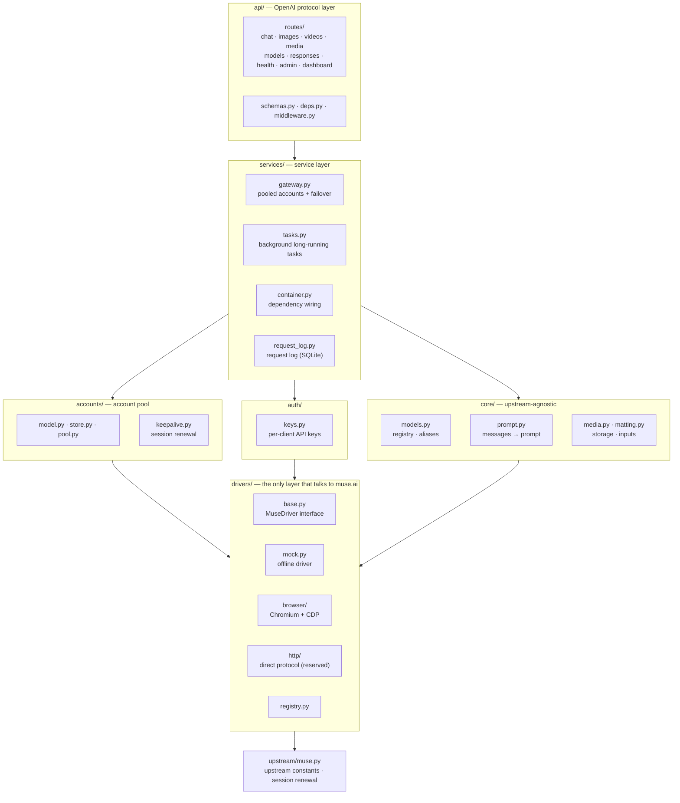

# Architecture

## Layers



This is a single-process modular monolith: React/TypeScript calls same-origin admin APIs; FastAPI routes delegate scheduling/import/login workflows to services. `Gateway` owns failover, `AccountManager` owns parsing and administrative updates, and `BrowserLoginManager` owns temporary authentication contexts. `AccountPool` owns leases and scheduling; driver adapters own upstream behavior. Status/quota routes query the driver through the injected service container. Drivers never depend on HTTP response schemas. No Redis or separate orchestration service is required.

## Lifecycle of a chat request

1. `routes/chat.py` validates the request, `resolve_model` resolves aliases, and `flatten_messages` merges the conversation into a single prompt and extracts images.
2. `Gateway.chat_stream` leases an account through `AccountPool.lease()` (chosen by the configured strategy and subject to the per-account concurrency limit).
3. It calls `driver.chat_stream(account, ChatRequest)` and receives text deltas.
4. On failure:
   - `UpstreamAuthError`: the account is marked `invalid`;
   - `UpstreamQuotaError`: the account cools down for at least one hour;
   - any other retryable error: the account cools down for `account_cooldown` seconds;
   - if nothing has been sent to the client yet, the request is retried on another account (up to `max_failover` times).
5. For streaming, the route pulls the first delta before returning 200, so errors such as "no account available" or "upstream authentication failed" come back with the right HTTP status code.

## Driver contract

```python
class MuseDriver(ABC):
    name: str
    requires_account: bool
    capabilities: DriverCapabilities

    async def startup(self) / shutdown(self)
    async def health(self) -> dict
    def chat_stream(self, account, ChatRequest) -> AsyncIterator[str]   # required
    async def generate_image(self, account, ImageRequest) -> list[MediaResult]
    async def generate_video(self, account, VideoRequest) -> MediaResult
    async def renew_session(self, account) -> SessionInfo
    async def quota(self, account) -> dict
```

- Unimplemented capabilities raise `FeatureNotImplemented` (HTTP 501) so the upper layers can degrade gracefully.
- Errors must be mapped to the `Upstream*` types in `errors.py`; the account pool relies on them to decide an account's state.
- Drivers are not responsible for retries, persistence or building URLs.

## Browser driver notes

- One Chromium process. Each account gets its own isolated browser context via `Target.createBrowserContext` (up to `MUSE2API_ACCOUNT_MAX_CONCURRENCY` tabs, one window per tab — Chromium throttles background tabs of a shared window), so switching accounts never requires clearing cookies.
- Follow-up chat from the same owner can reuse that account's conversation and send only the new user text. A different history or `user` opens a fresh page. The default is fair `round_robin`; select `affinity` when account-sticky conversation reuse is preferred. Round-robin does not guarantee the next turn uses the same account.
- All DOM selectors and in-page scripts live in `drivers/browser/dom.py`. When muse.ai changes its UI, this is usually the only file that needs updating.
- Text is written into the textarea through the native value setter plus an `input` event, so React picks it up and long prompts stay fast. If the send button cannot be found, it falls back to pressing Enter.
- Output detection polls the text of the last assistant bubble and emits the new part. The reply is considered finished once the Stop button is gone and the text has stopped changing.
- Media: wait for a new attachment node, then `fetch()` its `blob:` URL inside the page and return the bytes as base64.

## Execution safety (v0.3.1)

- Chat reuse is namespaced by a digest of the authenticated API-key id and optional `user`; a client-supplied `user` is not an identity. Identical namespaces serialize while independent namespaces may run concurrently. Sharing a key is sharing that namespace, not a new security boundary.
- Media operations do not automatically fail over and replay a generation: the existing browser protocol cannot prove whether an upstream submission succeeded before a timeout. Callers must inspect results before manually retrying; exactly-once generation and partial multi-image recovery are not claimed.
- Cancellation confirms local execution cleanup only, not upstream cancellation or a refund. Interrupted browser tabs are retired rather than returned to the clean reusable pool.
- Task history retention applies only to terminal records. Queued/running records are never evicted by the history cap. Runner concurrency is bounded, immediate cancellation has a terminal persisted outcome, and restart marks unfinished work interrupted rather than replaying it.

## Persistence and scheduling

- `SQLiteAccountStore` stores whole account payloads encrypted with Fernet, including cookies, expirations and private driver metadata. `accounts.db` and `credentials.key` must be backed up together. Missing or incorrect keys fail startup without replacing existing data.
- Existing `accounts.json` is imported transactionally once; its plaintext original is deliberately preserved. Runtime policy is persisted separately. SQLite snapshots are appropriate for a small single-process account pool, not distributed workers.
- Pool leases capture credential revisions and account snapshots. Replacing credentials or deleting an account cannot let an old in-flight result invalidate the replacement. Concurrency slots are released on cancellation, generator close and failure; upstream iterators close before their lease is returned.
- Busy accounts wait until the acquire deadline, cooling accounts re-enter after their deadline, invalid/disabled accounts are excluded. Failover stops once nonempty content has been emitted. Changing a strategy wakes waiters and survives restart.
- Browser contexts are retired on credential replacement; active tabs finish against their original context before disposal. The driver launches only its own Chromium process and rejects an already occupied CDP port instead of attaching to an unknown browser.

## Console and manual login

- `frontend/src` contains separate pages, shared API/types/UI and the login controller. Vite emits `web/dashboard.html` plus fingerprinted `/assets/*`; FastAPI serves them with a restrictive console CSP and no-store HTML.
- Admin authentication remains a Bearer key stored only in tab-scoped `sessionStorage`. All import, pool-policy and login-session routes require admin authentication. Public account responses use an explicit whitelist and do not return cookies or private metadata.
- Cookie imports preview each row before committing; duplicate sessions and malformed rows have independent results. Browser exports and Netscape records are filtered to Muse domains; raw headers without domain information require the operator to select the correct export.
- Manual login allocates a separate temporary browser context with configurable TTL/limit. Only bounded click/text/key/scroll events are accepted, not arbitrary JavaScript or CDP commands. Successful completion extracts the required Muse cookies, validates the upstream assigned session, imports once and disposes the context. Closing, expiry and shutdown also clean up. Screenshots and inputs are not persisted by this workflow.
- Offline tests use fake CDP and upstream validators. They verify contracts and cleanup, not Muse's current authentication challenge or live generation. Mock/HTTP drivers report 501 for unsupported browser login.

## Roadmap

Reserved modules and outstanding work are tracked in [TODO.md](../TODO.md) at the repository root.
