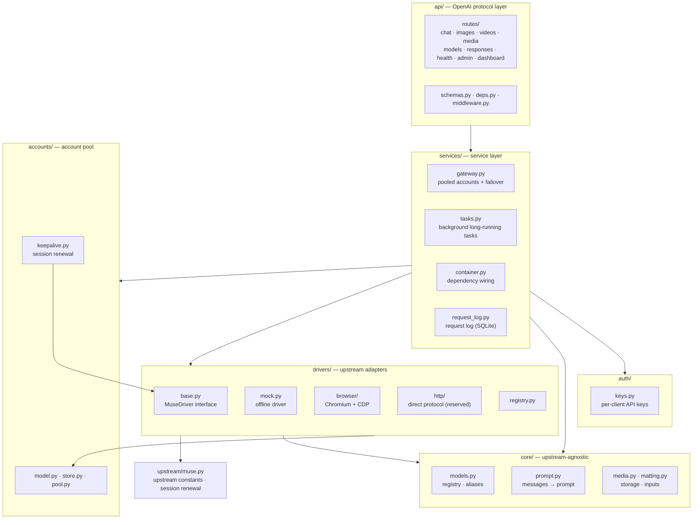

# Muse Console Architecture

[English](ARCHITECTURE.md) | [简体中文](ARCHITECTURE.zh-CN.md)

The distribution and CLI are `muse-console`; the Python module/package is `muse_console` (`python -m muse_console`). Source paths in this document are relative to `src/muse_console/` unless stated otherwise. Configuration uses `MUSE_CONSOLE_`; the core configuration layer retains legacy `MUSE2API_` aliases and gives the new name precedence when both are supplied.

## Layers



This is a single-process modular monolith: React/TypeScript calls same-origin admin APIs; FastAPI routes delegate scheduling/import/login workflows to services. `Gateway` owns failover, `AccountManager` owns parsing and administrative updates, and `BrowserLoginManager` owns temporary authentication contexts. `AccountPool` owns leases and scheduling; driver adapters own upstream behavior. Status/quota routes query the driver through the injected service container. Drivers never depend on HTTP response schemas. No Redis or separate orchestration service is required.

The diagram shows major collaboration paths, not a strict package-import DAG. Drivers consume account/credential types and core helpers; only account keepalive calls the driver contract, while `auth/` and `core/` do not depend on drivers. `upstream/muse.py` centralizes Muse constants and the direct-HTTP renewal helper invoked by adapters. API routes also use core normalization and driver request types. `drivers/http/` reserves direct generation transport: chat/image/video generation is not implemented; session renewal is implemented. The default `mock` driver is for offline behavior, not proof of live upstream capability.

## Lifecycle of a chat request

1. `api/routes/chat.py` validates the request, `resolve_model` resolves aliases, and `flatten_messages` merges the conversation into a single prompt and extracts images.
2. `Gateway.chat_stream` leases an account through `AccountPool.lease()` (chosen by the configured strategy and subject to the per-account concurrency limit).
3. It calls `driver.chat_stream(account, ChatRequest)` and receives text deltas.
4. On failure:
   - `UpstreamAuthError`: the account is marked `invalid`;
   - `UpstreamQuotaError`: the account cools down for at least one hour;
   - `UpstreamTimeout`: the failure is recorded without cooling the account;
   - other retryable errors: the account cools down for `account_cooldown` seconds;
   - only a retryable upstream error before any nonempty delta, with an alternative enabled/valid account, permits failover (up to `max_failover` times).
5. With the default `stream_heartbeat_interval=0`, the route pulls the first delta before returning 200, so initial account/upstream errors retain their HTTP status. Enabling heartbeats commits HTTP 200 before the first delta and sends keepalive comments; subsequent errors are SSE error payloads, not a changed HTTP status. Once streaming has started, later errors are also reported in the event stream.

## Driver contract

```python
class MuseDriver(ABC):
    name: str
    requires_account: bool
    capabilities: DriverCapabilities

    async def startup(self) / shutdown(self)
    async def health(self) -> dict
    def chat_stream(self, account, ChatRequest) -> AsyncIterator[str]   # required
    async def generate_image(self, account, ImageRequest) -> list[MediaResult]
    async def generate_video(self, account, VideoRequest) -> MediaResult
    async def renew_session(self, account) -> SessionInfo
    async def quota(self, account) -> dict
```

- Unimplemented capabilities raise `FeatureNotImplemented` (HTTP 501) so the upper layers can degrade gracefully.
- Errors must be mapped to the `Upstream*` types in `errors.py`; the account pool relies on them to decide an account's state.
- Gateway owns cross-account failover; drivers do not own application persistence or public media URL construction. Browser-local bounded recovery and the text-only video retry described below are explicit exceptions, not a general replay guarantee.

## Browser driver notes

- One Chromium process. Each account gets its own isolated browser context via `Target.createBrowserContext` (up to `MUSE_CONSOLE_ACCOUNT_MAX_CONCURRENCY` tabs, one window per tab — Chromium throttles background tabs of a shared window), so switching accounts never requires clearing cookies.
- Follow-up chat from the same owner can reuse that account's conversation and send only the new user text. A different history or `user` opens a fresh page. The default is fair `round_robin`; select `affinity` when account-sticky conversation reuse is preferred. Round-robin does not guarantee the next turn uses the same account.
- Composer selectors, submission adapters and reply snapshots live in `drivers/browser/dom.py`. Browser-specific navigation, media and session-probe scripts also exist in the driver and `session_auth.py`; upstream UI/protocol changes may require coordinated updates.
- Waiting for a media attachment is decided by the pure state machine `drivers/browser/media_wait.py` (grace → one "please attach" follow-up → short grace → link probe → `media_missing`); the driver only performs the I/O it requests. Tune timings there and in `BrowserDriver._MEDIA_GRACE` / `_ASK_GRACE`.
- A video whose reply arrives as text only is re-submitted on the same account up to `MUSE_CONSOLE_VIDEO_TEXT_ONLY_RETRIES` times while at least 100s of `MUSE_CONSOLE_VIDEO_DEADLINE_CAP` remain. This is a deliberate, bounded exception to "no media replay": a text-only reply is a completed upstream answer, not an unknown submission.
- Navigation requires a matching frame/loader/path barrier. If the navigation command times out on a fresh `about:blank` target, one bounded read-only check may confirm a new stable loader at the exact expected origin/path. It never navigates again or replays a submission; ambiguous state still fails.
- Submission waits for the current composer, chat subscription, history, approval safety and RPC transport to be ready. The bounded React committed-context adapter lives in `dom.py`; an incompatible schema blocks submission rather than falling back. Input uses the native textarea setter plus an `input` event. Readiness and binding are rechecked before one scoped Send click; there is no blind Enter fallback or automatic replay. A click or thread-creation HTTP 200 is not proof of message acceptance.
- Output detection polls the text of the last assistant bubble and emits the new part. The reply is considered finished once the Stop button is gone and the text has stopped changing. Generation detection uses the language-independent `hatch-composer-stop-button` data-testid, retaining the English Stop aria-label selector for compatibility with older markup.
- The browser's first-token timeout defaults to 45 seconds after submission returns and is a soft limit while generation is visibly active. After handling pending approval cards, each snapshot is checked for valid new assistant text before reporting a first-token timeout; a first completed reply observed past that limit is accepted even if Stop is already gone. Empty text or unchanged baseline text (without a new bubble) does not count. This ordering does not extend the total reply timeout, alter stable-completion checks or replay submissions; it is not a fix or diagnosis for residual upstream 504s.
- Media: wait for a new attachment node. Strict Muse-origin blob URLs are streamed and byte-counted in the owned page, then returned as bounded base64; HTTP(S) links use the public-only downloader without Muse credentials. Authentication-required HTTP links fail rather than fall back to an unsafe page fetch.
- Chat completion requires stable text with generating false; a stable pause while generation remains active does not mean completion. New checkouts may reconnect only to the exact CDP endpoint obtained from this process's launch. Existing generations are never replayed by recovery; a dead Chromium process needs an explicit service restart.
- Generation tabs have a global budget and idle LRU/TTL cleanup. Manual-login and credential-validation contexts have separate bounds; this is not an OS memory limit. Use container/systemd memory and egress limits as additional deployment controls.

## Execution safety

- Chat reuse is namespaced by a digest of the authenticated API-key id and optional `user`; a client-supplied `user` is not an identity. Identical namespaces serialize while independent namespaces may run concurrently. Sharing a key is sharing that namespace, not a new security boundary.
- Media operations do not automatically fail over and replay a generation: the existing browser protocol cannot prove whether an upstream submission succeeded before a timeout. Callers must inspect results before manually retrying; exactly-once generation and partial multi-image recovery are not claimed.
- Cancellation confirms local execution cleanup only, not upstream cancellation or a refund. Interrupted browser tabs are retired rather than returned to the clean reusable pool.
- Task history retention applies only to terminal records. Queued/running records are never evicted by the history cap. Runner concurrency is bounded, immediate cancellation has a terminal persisted outcome, and restart marks unfinished work interrupted rather than replaying it.

## Ownership and capacity

- `Task.owner_key_id` is persisted at submission. Ordinary keys can poll only their own jobs; the administrator can inspect all. Ownerless legacy jobs are admin-only. There is no ownership inference from task payloads.
- `media-owners.db` maps files to keys. `media-signing.key` signs expiring bearer links; both are part of a complete data backup. Key-authenticated downloads require owner/admin identity, signed links expire and stored-key revocation invalidates them. Link possession is still temporary delegated access, not a private session.
- Task polling refreshes media links only after ownership authorization. Legacy files are not assigned to a guessed user. Downloads are private/no-store; reverse proxies must not cache them or log query signatures.
- ASGI admission bounds generation HTTP requests and request bytes before parsing. `TaskManager` independently bounds all queued/running jobs. Browser generation tabs, input image bytes, output bytes and total media storage have separate budgets. These process-local budgets do not implement rate billing or distributed scheduling.
- URL image input resolves every DNS address, rejects non-public destinations, connects to a validated IP with original hostname TLS verification, and repeats validation for every redirect. Ambient proxies/cookies/auth are absent; compressed and decoded streams are bounded. Generated HTTP(S) result links use the same public-only downloader without browser credentials; failures never fall back to browser fetch. Only strict Muse-origin blob URLs use bounded owned-page retrieval. Network egress restrictions remain defense in depth.
- Conversation namespace isolation cannot remove account-level Muse memory. A shared upstream account is not a privacy boundary between untrusted tenants; system prompts cannot guarantee otherwise.

## Persistence and scheduling

- `SQLiteAccountStore` stores whole account payloads encrypted with Fernet, including cookies, expirations and private driver metadata. `accounts.db` and `credentials.key` must be backed up together. Missing or incorrect keys fail startup without replacing existing data.
- Existing `accounts.json` is imported transactionally once; its plaintext original is deliberately preserved. Runtime policy is persisted separately. SQLite snapshots are appropriate for a small single-process account pool, not distributed workers.
- Pool leases capture credential revisions and account snapshots. Replacing credentials or deleting an account cannot let an old in-flight result invalidate the replacement. Concurrency slots are released on cancellation, generator close and failure; upstream iterators close before their lease is returned.
- Busy accounts wait until the acquire deadline, cooling accounts re-enter after their deadline, invalid/disabled accounts are excluded. Failover stops once nonempty content has been emitted. Changing a strategy wakes waiters and survives restart.
- Browser contexts are retired on credential replacement; active tabs finish against their original context before disposal. The driver launches only its own Chromium process and rejects an already occupied CDP port instead of attaching to an unknown browser.

### Stored data boundaries

Account encryption is not whole-data-directory encryption. `tasks.json` stores task requests/results/errors and ownership; media files store generated bytes, with ownership and signing material alongside them. `requests.db` records request metadata (including key/account ids, client IP, user agent and errors), not a full conversation archive. `keys.json` stores client key hashes and metadata; the persisted legacy `api_key`, account encryption key and media signing key are secrets. `credential-devices.db` holds device grant hashes, bindings and redacted receipts, not a raw-cookie archive. Protect the complete data directory and backups with filesystem access controls; do not publish runtime files or browser profiles. Media age-based cleanup is disabled by default (`media_retention_days=0`); capacity limits are not an automatic retention policy.

## Console and manual login

- `frontend/src` contains separate pages, shared API/types/UI and the login controller. Vite emits `src/muse_console/web/dashboard.html` plus fingerprinted `/assets/*`; FastAPI serves them with a restrictive console CSP and no-store HTML.
- Admin authentication remains a Bearer key stored only in tab-scoped `sessionStorage`. All import, pool-policy and login-session routes require admin authentication. Public account responses use an explicit whitelist and do not return cookies or private metadata.
- Cookie imports preview each row before committing; duplicate sessions and malformed rows have independent results. Browser exports and Netscape records are filtered to Muse domains; raw headers without domain information require the operator to select the correct export.
- Manual login allocates a separate temporary browser context with configurable TTL/limit. Only bounded click/text/key/scroll events are accepted, not arbitrary JavaScript or CDP commands. Successful completion extracts the required Muse cookies, validates the upstream assigned session, imports once and disposes the context. Closing, expiry and shutdown also clean up. Screenshots and inputs are not persisted by this workflow.
- Offline tests use fake CDP and upstream validators. They verify contracts and cleanup, not Muse's current authentication challenge or live generation. Mock/HTTP drivers report 501 for unsupported browser login.

## Automatic credential ingestion

`extension/` is a separate MV3 TypeScript build, not a new server process. Its service worker reads only Muse's allowlisted cookies with the official API. Initial installation, target-origin permission and synchronization consent are explicit. It never launches/restarts the user's browser, opens its profile files, mutates cookie storage, or exports authentication-provider cookies. All durable extension state is redacted except the restricted device token; transient raw snapshots stay in trusted session storage. Cookie stores and actual frame partitions are separate sources, not globally merged.

`CredentialEnvelope` / `CookieRecord` retain domain, path, host-only scope, HttpOnly, SameSite, session/expiry and partition keys. Duplicate or ambiguous names, mixed partitions and expired values fail closed. Legacy name/value imports remain compatible but unknown attributes are not fabricated. Browser injection respects the original expiry rather than extending it. `Settings.ensure_dirs`, browser startup and Chromium launch reject protected main-profile roots/parents and symlink/junction/reparse ancestors before writes. Chromium launch also requires a valid project ownership marker (`.muse-console-owned-profile` (valid legacy `.muse2api-owned-profile` markers remain recognized)); only an empty directory may be claimed automatically. Existing nonempty, unmarked profiles fail closed, including old project profiles: use a new empty directory or perform an explicitly authorized manual migration rather than stamping unknown data. These guards prevent accidental reuse, not marker forgery or concurrent directory replacement; they are not a filesystem sandbox.

`CredentialDevices` stores hashed, expiring/revocable/rotatable device grants, one-use pairing challenges, source bindings and redacted capture receipts in a separate SQLite database. `CredentialIngestion` caps body size, read/probe timeouts and concurrency; one device can query only its own captures. No admin key or arbitrary target URL is accepted on the device path. HTTPS exact-origin checking and transport authentication are independent of CORS. TLS-terminating deployments must restrict backend reachability and explicitly trust only their fixed proxy; application code does not parse forwarding headers to choose an origin.

`BrowserCredentialValidator` delegates to the driver-layer `probe_session`: allocate an owned temporary context, restore exact cookie scope, fetch the fixed Muse session endpoint inside that origin, read rotated cookies from that context only, then dispose on success/failure/cancellation. No generation, VM wake, main-browser access or HTTP-success fallback. A positive assigned session is not proof of generation or cross-device portability. The account subject is the `vm_id` that `/api/session` reports, not any `hatch_*` cookie: two profiles of the same Muse account share the workspace id while every cookie value differs. A capture whose subject already owns a pool entry is adopted into that entry (version +1, source bound, no new-account quota spent); an absent or conflicting subject still requires capture-specific identity confirmation. Duplicate entries that predate this rule are folded together with `POST /admin/accounts/{id}/merge`, which keeps the higher `credential_version`, moves device bindings, and drops the other entry in one commit.

Commits use a single-account credential lock, monotonically increasing `credential_version` and CAS. Backend renewal is the only proactive refresh owner; extension uploads are candidates. Confirmation is scoped to one captured payload and the current target version, never a blanket binding grant. A newer server version causes conflict/reconfirmation, not a blind client base-version bump. Account commits carry an encrypted recovery marker; startup repairs receipts/bindings after interruption between the account and device databases. Historical receipts acknowledge past commits, not current login health. Receipt retention is bounded (30 days / 10k rows); source quota/revision high-water marks survive pruning.

Renewal uses expiry-aware jitter, bounded timeouts and persisted backoff. Network errors preserve previous credentials; explicit rejection/expiry marks `needs_reauth` / invalid. Both administrative renewal and background renewal serialize per account. Feature switches default off. Optional isolated login auto-completion follows same-context OAuth targets, validates in the owned context, saves scoped records and retains a short completed status after cleanup so the UI can acknowledge it.

The repository includes offline tests for ASGI pairing/import/renewal/restart/revocation, fake-CDP context isolation and cancellation, scope round-trips, encrypted persistence, stale-version protection, read-only extension mocks and console device operations. These test contracts do not establish current live upstream compatibility. Any earlier authorized live sample is historical evidence only, not acceptance of the current revision; separate live regression is required. The ≤10s import target, multi-account load and 72-hour renewal observation remain unverified. Offline tests and read-only health monitoring do not establish those gates.

## Roadmap

Reserved modules and outstanding work are tracked in [TODO.md](../TODO.md) at the repository root.
