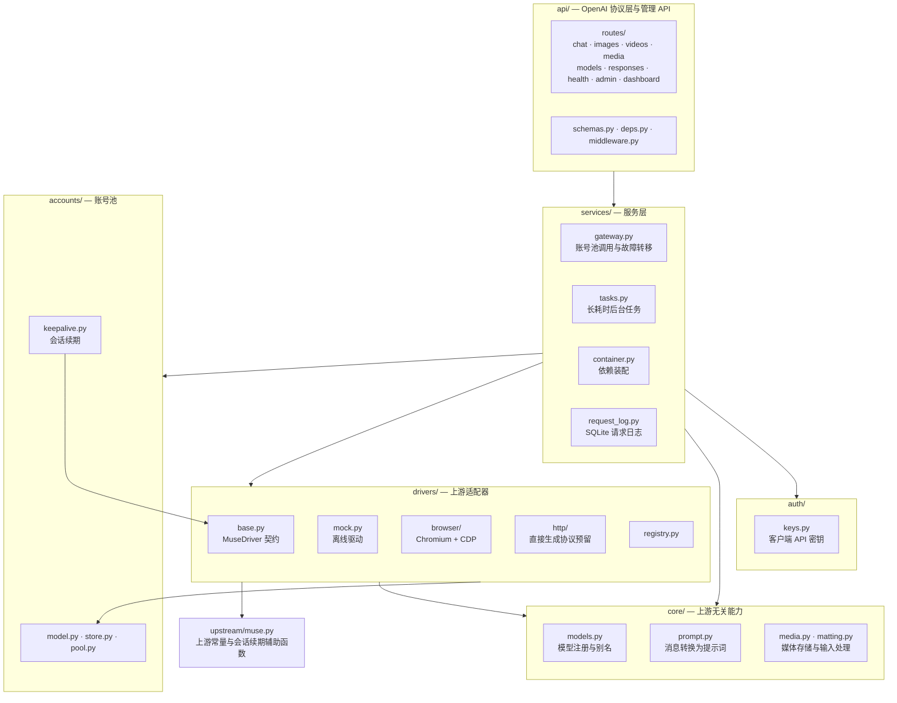

# Muse Console 架构

[English](ARCHITECTURE.md) | [简体中文](ARCHITECTURE.zh-CN.md)

发行包和命令行名称为 `muse-console`，Python 模块/包名为 `muse_console`（`python -m muse_console`）。除非另有说明，下文源码路径均相对于 `src/muse_console/`。配置使用 `MUSE_CONSOLE_` 前缀；核心配置层兼容旧的 `MUSE2API_` 别名，同时提供两者时新名称优先。

本文描述当前实现及其边界，不把预留接口、离线测试或历史验证当作已交付的上游能力。

## 分层与依赖



这是单进程的模块化单体：React/TypeScript 控制台调用同源管理 API，FastAPI 路由将调度、导入和登录流程交给服务层。`Gateway` 负责故障转移，`AccountManager` 负责导入解析和管理更新，`BrowserLoginManager` 管理临时认证上下文；`AccountPool` 负责租约与调度，驱动负责上游行为。状态和配额路由通过注入的服务容器查询驱动。驱动不依赖 HTTP 响应 schema，不需要 Redis 或独立编排服务。

图中箭头表示主要协作关系，不是严格的包导入有向无环图。驱动使用账号/凭据类型及 core 辅助能力；账号层中由 keepalive 调用驱动契约，`auth/`、`core/` 不依赖驱动。`upstream/muse.py` 集中维护 Muse 常量和供适配器调用的直接 HTTP 续期函数。API 路由也使用 core 规范化函数和驱动请求类型。

`drivers/http/` 的直接生成传输仍为预留：聊天、图片和视频生成尚未实现，会话续期已实现。默认 `mock` 驱动用于离线行为验证，不能证明真实上游可用。

## 聊天请求生命周期

1. `api/routes/chat.py` 校验请求，`resolve_model` 解析模型别名，`flatten_messages` 将对话合并为提示词并提取图片。
2. `Gateway.chat_stream` 通过 `AccountPool.lease()` 获取账号；选择遵循配置的调度策略和单账号并发限制。
3. 调用 `driver.chat_stream(account, ChatRequest)`，消费文本增量。
4. 出错时：
   - `UpstreamAuthError`：账号标记为 `invalid`。
   - `UpstreamQuotaError`：冷却至少一小时。
   - `UpstreamTimeout`：记录失败，但不因此冷却账号。
   - 其他可重试错误：冷却 `account_cooldown` 秒。
   - 只有在尚未输出非空增量、错误可重试且存在其他已启用的有效账号时，才允许跨账号故障转移，最多 `max_failover` 次。
5. 默认 `stream_heartbeat_interval=0` 时，路由在返回 HTTP 200 前预取首段，因此初始账号/上游错误保留相应 HTTP 状态。启用心跳后会先提交 HTTP 200、在首段到来前发送 SSE keepalive 注释，之后的错误以 SSE 错误载荷返回，不能更改 HTTP 状态。流开始后的其他错误同样在事件流中报告。

## 驱动契约

以下为简化接口，具体参数类型以 `drivers/base.py` 为准：

```python
class MuseDriver(ABC):
    name: str
    requires_account: bool
    capabilities: DriverCapabilities

    async def startup(self) / shutdown(self)
    async def health(self) -> dict
    def chat_stream(self, account, ChatRequest) -> AsyncIterator[str]   # 必须实现
    async def generate_image(self, account, ImageRequest) -> list[MediaResult]
    async def generate_video(self, account, VideoRequest) -> MediaResult
    async def renew_session(self, account) -> SessionInfo
    async def quota(self, account) -> dict
```

- 未实现的能力抛出 `FeatureNotImplemented`，映射为 HTTP 501，让上层明确处理能力缺失。
- 驱动错误需映射为 `errors.py` 中的 `Upstream*` 类型，账号池据此更新状态。
- `Gateway` 负责跨账号故障转移；驱动不负责应用持久化或对外媒体 URL 的构造。下文的浏览器局部有界恢复和纯文本视频回复重试是明确例外，不构成通用重放保证。

## 浏览器驱动

- 使用一个 Chromium 进程，通过 `Target.createBrowserContext` 为每个账号建立独立上下文，无需在切换账号时清空 Cookie。每个账号最多使用 `MUSE_CONSOLE_ACCOUNT_MAX_CONCURRENCY` 个标签页，每页单独开窗，以避免共享窗口中的后台标签页被 Chromium 节流。
- 同一归属命名空间的后续聊天可复用该账号的会话，只发送新增用户文本；历史不匹配或 `user` 不同则新开页面。默认 `round_robin` 强调轮转公平性；需要账号粘性时可选 `affinity`。轮转不保证下一轮仍使用同一账号。
- 编辑器选择器、提交适配器和回复快照集中在 `drivers/browser/dom.py`；导航、媒体和会话探测脚本也存在于驱动及 `session_auth.py`。上游 UI/协议变更可能需要协同修改多处，不能假定只改 DOM 文件即可。
- 媒体等待由纯状态机 `drivers/browser/media_wait.py` 决定：宽限等待 → 一次请求附加媒体的追问 → 短宽限等待 → 链接探测 → `media_missing`。驱动只执行状态机要求的 I/O；时序参数位于该文件及 `BrowserDriver._MEDIA_GRACE` / `_ASK_GRACE`。
- 视频生成若收到已完成但仅含文本的回复，可在同一账号上重新提交，次数最多为 `MUSE_CONSOLE_VIDEO_TEXT_ONLY_RETRIES`，且整体预算（受 `MUSE_CONSOLE_VIDEO_DEADLINE_CAP` 限制）至少还剩 100 秒。这是“不重放媒体生成”的有界例外：纯文本回复是已完成的上游回答，不是提交状态未知。
- 导航需通过 frame、loader 和路径匹配屏障。新建 `about:blank` 目标上的导航命令超时后，可进行一次有界只读检查，确认新稳定 loader 位于精确预期的源和路径；不会再次导航或重放提交，状态不明确仍然失败。
- 提交前需确认当前编辑器、聊天订阅、历史、审批安全状态和 RPC 传输就绪。`dom.py` 中的 React 已提交上下文适配器有界且按已知结构工作；结构不兼容时阻止提交，不盲目降级。文本通过原生 textarea setter 和 `input` 事件写入，重新校验就绪状态和绑定后只执行一次限定范围的 Send 点击，无盲目 Enter 回退或自动重放。点击成功或创建线程返回 HTTP 200，不等于消息已被接受。
- 输出检测轮询最后一条助手消息并发送新增部分。只有生成停止且文本稳定才认为完成；仍在生成时的稳定暂停不算完成。生成状态优先使用与语言无关的 `hatch-composer-stop-button` data-testid，并保留旧版英文 Stop aria-label 兼容选择器。
- 首 token 超时默认从提交返回后计 45 秒，在可见生成仍进行时属于软限制。处理待审批卡片后，先检查快照是否有有效的新助手文本，再判断首 token 超时；首次看到已完成回复时，即使已超过该限制且 Stop 已消失，也接受有效新文本。空文本或没有新消息气泡的未变基线不算新回复。此顺序不会延长回复总超时、改变稳定完成判定或重放提交，也不构成对残余上游 504 的诊断或修复。
- 媒体结果需等待新附件节点。严格匹配 Muse 源的 blob URL 仅在服务拥有的页面内流式读取并计数字节，再以受限 base64 返回；HTTP(S) 链接统一使用不携带 Muse 凭据的仅公网下载器。需要认证的 HTTP 链接失败后不会退回不安全的页面 fetch。
- 新租出的页面仅可重连到本进程启动时获得的精确 CDP 端点。恢复不会重放既有生成；Chromium 进程死亡需显式重启服务。
- 生成标签页有全局预算及空闲 LRU/TTL 清理；手动登录和凭据校验上下文另有限额。这不是操作系统内存上限，应叠加容器/systemd 内存和出站网络限制。

## 执行安全

- 聊天复用命名空间由已认证 API 密钥 id 与可选 `user` 的摘要组成；客户端提供的 `user` 不是身份认证。同一命名空间串行，不同命名空间可并行。共享密钥即共享命名空间，不能据此创建新的安全边界。
- 媒体操作不会自动跨账号故障转移并重放生成：现有浏览器协议不能证明超时前上游是否已经接受提交。调用方应先检查结果再手动重试；不承诺恰好一次生成或多图部分成功后的恢复。
- 取消只确认本地执行清理，不保证上游取消或退款。被中断的浏览器标签页会退役，而不是回到干净可复用池。
- 任务历史保留上限只作用于终态记录，排队/运行任务不会因此被淘汰。执行器并发有界，立即取消也有持久化终态；重启将未完成工作标为中断失败，不自动重放。

## 归属、权限与容量

- 提交任务时持久化 `Task.owner_key_id`。普通密钥只能轮询自己的任务，管理员可查看全部；无归属的旧任务仅管理员可见，不从任务载荷推断所有权。
- `media-owners.db` 保存文件与密钥的归属映射，`media-signing.key` 签发有过期时间的持有者链接，两者均属于完整数据备份的一部分。密钥认证下载要求所有者或管理员身份；签名链接会过期，存储型客户端密钥撤销也会使对应链接失效。持有链接是临时委托访问，不是私有会话认证。
- 轮询任务先做归属授权，再刷新媒体链接。旧文件不会被猜测分配给某个用户。下载响应为 `private, no-store`；反向代理不得缓存媒体或记录查询签名。
- ASGI 准入层在解析前限制生成 HTTP 请求并发和请求体字节数；`TaskManager` 独立限制所有排队/运行任务。浏览器生成标签页、输入图片、输出媒体及总媒体存储各有预算。这些进程内限制不是计费限流或分布式调度。
- URL 图片输入使用 `core/safe_download.py`：校验所有 DNS 返回地址，拒绝非公网目的地，连接已校验 IP，同时以原始主机名验证 TLS；每次重定向重复校验。不继承环境代理、Cookie 或认证，传输压缩字节和解码后字节均受限。生成结果的 HTTP(S) 链接使用同一下载器，不携带浏览器凭据，失败不回退浏览器 fetch。只有严格 Muse 源 blob URL 使用服务拥有页面的有界读取。出站网络限制仍是纵深防御，不能由应用校验替代。
- 对话命名空间隔离无法消除 Muse 账号级记忆。共享上游账号不是不互信租户间的隐私边界，系统提示词也不能保证该隔离。

## 持久化与调度

- `SQLiteAccountStore` 用 Fernet 加密完整账号载荷，包含 Cookie、过期时间和私有驱动元数据。`accounts.db` 与 `credentials.key` 必须成对备份；密钥丢失或错误会导致启动失败，不会替换已有数据。
- 已有 `accounts.json` 仅进行一次事务性导入，原始明文文件刻意保留。运行时策略单独持久化。SQLite 快照适用于小型单进程账号池，不适合作为分布式 worker 协调机制。
- 租约捕获凭据修订和账号快照；替换凭据或删除账号后，旧在途请求的结果不能将替换后的账号置为无效。取消、生成器关闭或失败都会释放并发槽；归还租约前先关闭上游迭代器。
- 忙碌账号最多等到获取截止时间；冷却账号到期后重新参与调度，无效/禁用账号排除。输出非空内容后停止透明故障转移。策略变更会唤醒等待者并在重启后保留。
- 凭据替换时旧浏览器上下文退役，活动页面仍使用原上下文完成后再销毁。驱动只启动自己拥有的 Chromium；CDP 端口已被占用时拒绝启动，不连接未知浏览器。

### 存储数据边界

账号加密不等于整个数据目录加密：

| 数据 | 当前用途与边界 |
| --- | --- |
| `accounts.db` / `credentials.key` | 加密账号载荷与解密密钥；必须一起保护与备份。 |
| `tasks.json` | 任务请求、结果、错误及归属信息，不是加密任务仓库。 |
| 媒体文件、`media-owners.db`、`media-signing.key` | 生成字节、归属映射及签名秘密；访问控制不等于静态加密。 |
| `requests.db` | 请求元数据，包括密钥/账号 id、客户端 IP、User-Agent 和错误；不是完整对话归档。 |
| `keys.json` / `api_key` | 前者保存客户端密钥哈希及元数据，后者是持久化的旧式单密钥秘密。 |
| `credential-devices.db` | 设备授权哈希、绑定和脱敏回执，不是原始 Cookie 归档。 |

完整数据目录及备份需要文件系统访问控制，运行时文件和浏览器配置目录不得公开。按媒体年龄清理默认关闭（`media_retention_days=0`），容量限制不是自动保留策略。

## 控制台与手动登录

- `frontend/src` 包含独立页面、共享 API/类型/UI 和登录控制器。Vite 输出 `src/muse_console/web/dashboard.html` 及指纹化 `/assets/*`，FastAPI 以限制性控制台 CSP 和不缓存的 HTML 提供服务。
- 管理认证使用 Bearer 密钥，仅存于标签页级 `sessionStorage`。所有导入、账号池策略和登录会话路由要求管理员认证。公开账号响应采用显式白名单，不返回 Cookie 或私有元数据。
- Cookie 导入先逐行预览再提交，重复会话和格式错误分别返回结果。浏览器导出与 Netscape 记录按 Muse 域过滤；不带域信息的原始请求头需由操作者确认选择正确来源。
- 手动登录使用独立临时浏览器上下文，TTL 和数量上限可配置。仅接受有界点击、文本、按键和滚动事件，不接受任意 JavaScript 或 CDP 命令。完成时提取所需 Muse Cookie，验证上游已分配会话，只导入一次并销毁上下文；关闭、过期和服务退出也会清理。此流程不持久化截图和输入。
- 离线测试使用伪 CDP 和上游校验器，只验证契约与清理，不证明 Muse 当前认证挑战或真实生成可用。Mock/HTTP 驱动对不支持的浏览器登录返回 501。

## 自动凭据接入

### 扩展与凭据范围

`extension/` 是独立构建的 MV3 TypeScript 扩展，不是新服务端进程。Service worker 仅通过官方 API 读取 Muse 白名单 Cookie。安装、目标源权限和同步同意均需显式授权；不会启动/重启用户浏览器、打开其配置文件、修改 Cookie 存储或导出认证提供方 Cookie。除受限设备令牌外，持久化扩展状态均脱敏，临时原始快照仅留在可信 session storage。Cookie store 与实际 frame partition 是分离来源，不会全局合并。

`CredentialEnvelope` / `CookieRecord` 保留域、路径、host-only 范围、HttpOnly、SameSite、会话/过期时间和 partition key。重复或歧义名称、混合分区和过期值均按失败关闭处理。旧式 name/value 导入仍兼容，但不会编造未知属性。浏览器注入遵循原始过期时间，不延长有效期。

`Settings.ensure_dirs`、浏览器启动和 Chromium 启动会在写入前拒绝主浏览器受保护目录及其父目录，并拒绝路径祖先中的符号链接、junction 和 reparse point。Chromium 还要求有效的项目所有权标记 `.muse-console-owned-profile`（仍识别有效旧标记 `.muse2api-owned-profile`）。仅空目录可自动认领，已有内容但无标记的目录（包括旧项目目录）拒绝使用；应选择新空目录或在明确授权后手工迁移，不能直接给未知数据补标记。这些检查防止误用，不防御标记伪造或并发目录替换，不是文件系统沙箱。

### 设备授权与校验

`CredentialDevices` 在独立 SQLite 数据库保存哈希化、可过期/撤销/轮换的设备授权、一次性配对挑战、来源绑定和脱敏采集回执。`CredentialIngestion` 限制请求体、读取/探测超时及并发；设备只能查询自己的采集记录。设备通道不接受管理员密钥或任意目标 URL。HTTPS 精确源校验与传输认证独立于 CORS。TLS 终止部署须限制后端可达性，且只显式信任固定代理；应用不解析转发头来决定源。

`BrowserCredentialValidator` 委托驱动层 `probe_session`：分配服务拥有的临时上下文，按精确范围恢复 Cookie，在固定 Muse 源内请求固定会话端点，仅从该上下文读取轮换后的 Cookie，并在成功、失败或取消时销毁。不生成、不唤醒 VM、不访问主浏览器，也不以普通 HTTP 成功作为回退。已分配会话不证明生成可用或跨设备可移植。

账号主体采用 `/api/session` 返回的 `vm_id`，而不是任何 `hatch_*` Cookie：同一 Muse 账号的不同浏览器配置可能 Cookie 全部不同，但工作区 id 相同。已验证主体若匹配池中账号，则采集结果更新该条目（版本加一、绑定来源、不消耗新账号额度）；主体缺失或冲突仍需针对该次采集确认身份。既有重复条目可通过 `POST /admin/accounts/{id}/merge` 合并：保留较高的 `credential_version`、迁移设备绑定，并在一次提交中删除另一条目。

### 提交、恢复与续期

提交使用单账号凭据锁、单调递增的 `credential_version` 和 CAS（比较并交换）。后端续期是唯一主动刷新方，扩展上传只是候选凭据。确认仅绑定某次采集载荷与目标当前版本，不是永久绑定授权；服务端已有更新版本时返回冲突/要求重确认，不盲目提升客户端基准版本。账号提交包含加密恢复标记；账号与设备两个数据库之间若发生中断，启动时修复回执和绑定。历史回执只确认过去提交，不代表当前登录健康。回执保留上限为 30 天/一万条，来源额度和修订高水位在裁剪后仍保留。

续期根据过期时间加入抖动，并使用有界超时和持久化退避。网络错误保留原凭据；明确拒绝或过期标记 `needs_reauth` / invalid。管理续期与后台续期均按账号串行。相关功能开关默认关闭。可选的隔离登录自动完成只跟随同上下文 OAuth 目标，在服务拥有上下文中校验并保存带范围的记录；清理后短暂保留完成状态供 UI 确认。

### 验证范围

仓库包含 ASGI 配对/导入/续期/重启/撤销、伪 CDP 上下文隔离与取消、范围往返、加密持久化、旧版本防护、只读扩展 mock 和控制台设备操作的离线测试。这些契约测试不能证明当前真实上游兼容性。任何早期获授权的在线样本都只是历史证据，不是当前修订的验收，需要单独在线回归。十秒以内导入、多账号负载和 72 小时续期观察仍未验证；离线测试和只读健康监测不能替代这些验收项。

## 后续工作

预留模块和待办事项见仓库根目录的 [TODO.md](../TODO.md)。
