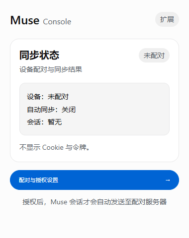
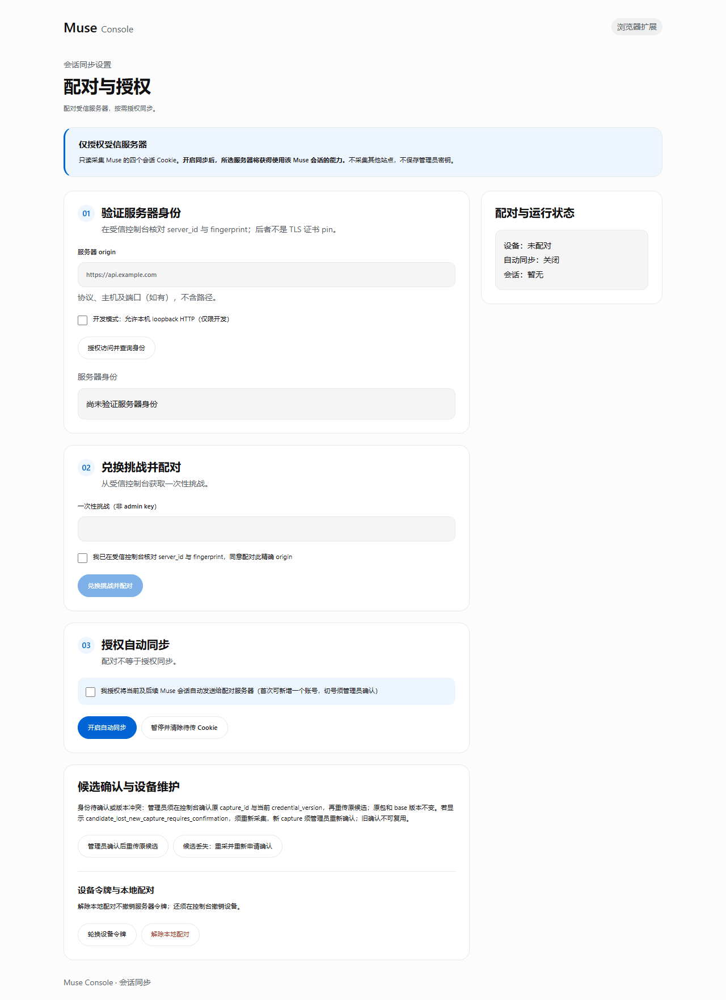

# Muse Console browser extension

English · [简体中文](README.zh-CN.md) · **0.2.0** · Chrome / Edge 132+ · MV3

Log in to Muse as usual and the extension syncs the session to **your own** Muse Console. No more manual cookie exports, and rotated sessions are picked up automatically.

<p>
  
</p>

> The extension UI is currently in Simplified Chinese.

## How it works

```text
You log in to muse.ai ──> extension reads 4 session cookies ──> paired Muse Console
                                                                 │ verifies in a temporary browser
                                                                 └ stores encrypted in the account pool
```

- **Read-only, minimal scope**: reads only `hatch_sess`, `hatch_gw`, `hatch_vml` and `hatch_native_auth_device` on `muse.ai`. No cookie writes, no content scripts, no other sites.
- **One exact target**: data goes only to the single server origin you enter and grant in options.
- **Verified before commit**: a failed session check never replaces existing credentials.
- **Restricted device token**: it can only upload candidates. It cannot read cookies, list accounts or call admin APIs, and can be revoked from the console at any time.

## Install

Not yet on a store. Build from source or use the zip attached to a release.

```bash
cd extension
npm ci
npm test
npm run package     # creates dist/ and release/muse-console-extension-0.2.0.zip
```

Open `chrome://extensions` (or `edge://extensions`), enable **Developer mode**, click **Load unpacked** and select `extension/dist`.

> Use a separate browser profile and log in only to the Muse account you want to connect.

## Use

Enable ingestion on the server first (off by default):

```bash
MUSE_CONSOLE_DRIVER=browser
MUSE_CONSOLE_CREDENTIAL_INGESTION_ENABLED=true
MUSE_CONSOLE_CREDENTIAL_SERVER_ORIGIN=https://console.example.com
```

1. **Verify the server**: in extension options enter the origin (for example `https://console.example.com`), grant access and compare `server_id` and `fingerprint` with the console.
2. **Pair**: in the console open *Account pool → Extension device pairing*, generate a one-time challenge and paste it into the extension.
3. **Enable sync**: tick the consent box and turn on automatic sync.
4. **Log in to Muse** in that browser. The popup shows “同步正常” (synced) when done.

<p>
  
</p>

For local development, tick *development mode* to reach `http://127.0.0.1:18610` and set `MUSE_CONSOLE_CREDENTIAL_ALLOW_LOOPBACK_HTTP=true` on the server. Remote targets must use HTTPS.

## Status

| Popup | Meaning | Action |
|---|---|---|
| 同步正常 · Synced | Session stored in the pool | None |
| 等待登录 Muse · Waiting for login | No valid session found | Log in to muse.ai in this browser |
| 等待管理员确认 · Needs admin | Unknown identity or version conflict | Confirm the candidate in the console, then resend it from options |
| 上传遇到问题 · Upload problem | Network/server error; retried with backoff | Check server and network |
| 设备授权已撤销/已过期 · Revoked/expired | Token no longer valid | Pair again |

Each device may add one new account by default. Later updates for the same account merge automatically; switching to another account requires admin confirmation.

## Stop and revoke

- **Pause** stops uploads and clears pending candidates.
- **Forget pairing** clears local pairing data.
- **Revoke** the device in the console to invalidate its token. Forgetting locally does not delete server accounts.

## Permissions

| Permission | Purpose |
|---|---|
| `cookies` + `https://muse.ai/*` | Read Muse session cookies |
| `webNavigation` | Trigger capture after Muse pages load |
| `alarms` | Debounce and retries |
| `storage` | Pairing data; raw captures stay in session storage and clear when the browser closes |
| Optional host access | Only for the server origin you grant in options |

No `tabs`, `scripting`, content scripts or external messaging. Disabled in incognito.

## Development

```bash
npm test                 # unit tests, including permission and static safety checks
npm run build            # type-check and bundle into dist/
npm run package          # build plus reproducible zip and SHA-256
```

Sources: `src/worker.ts` (events), `src/collector.ts` (cookie capture), `src/engine.ts` (pairing, upload, retry), `src/policy.ts` (origin and cookie allowlist), `src/status-view.ts` (status text).

Serve `preview.html` over local HTTP for a static, disabled preview without installing the extension.

See [Architecture](../docs/ARCHITECTURE.md) and [Deployment §6](../docs/DEPLOYMENT.md#6-extension-pairing-separate-exact-authorization) for details.

## License

MIT, same as the main project. The UI font subset is derived from Noto Sans CJK SC (SIL OFL 1.1); see `fonts/`.
